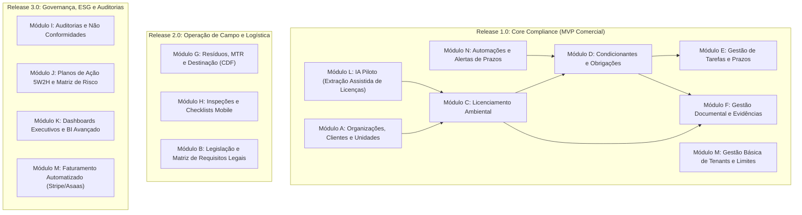
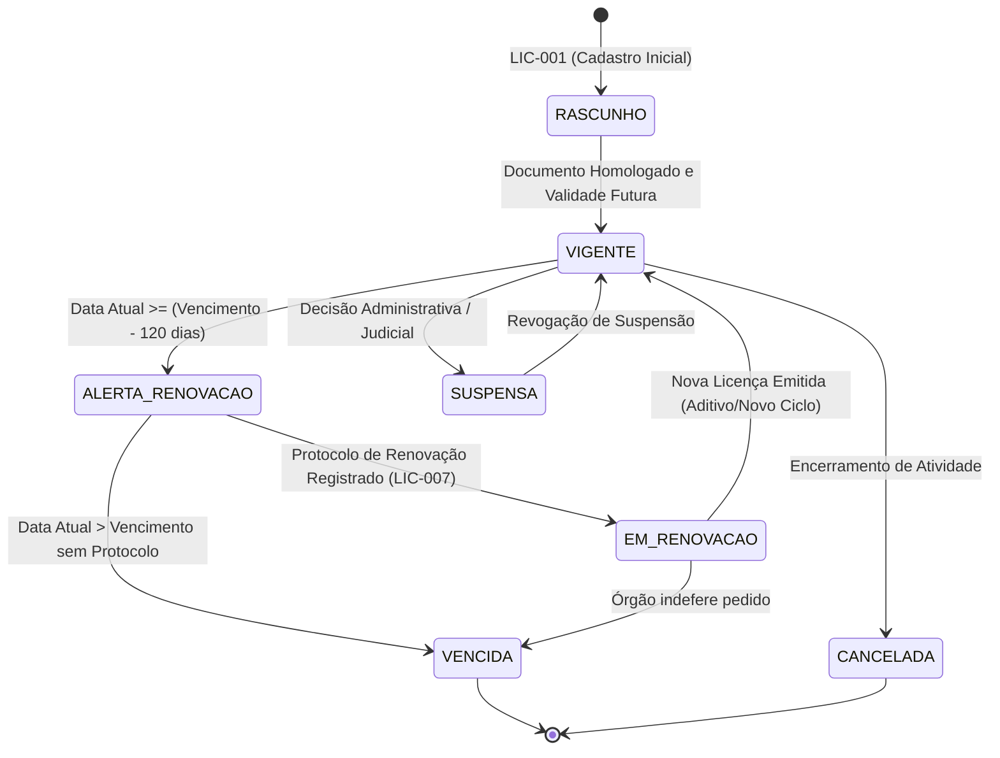
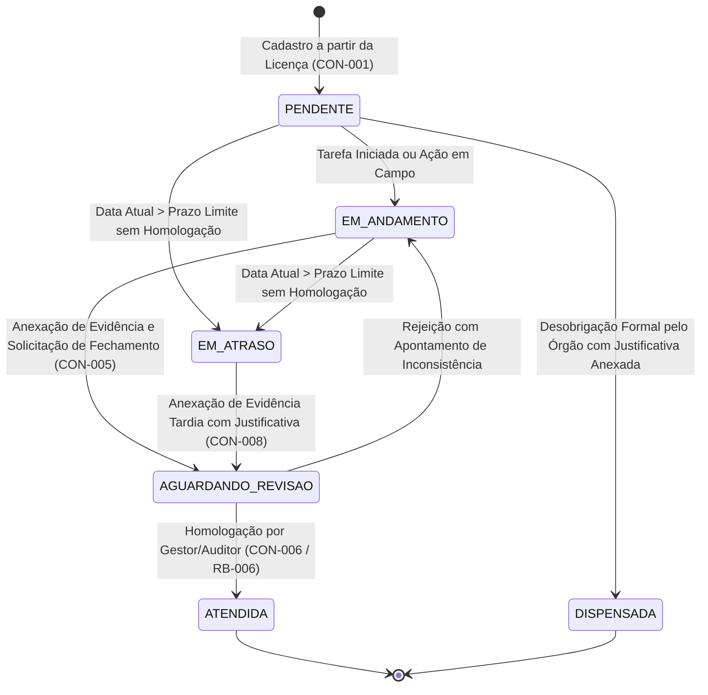
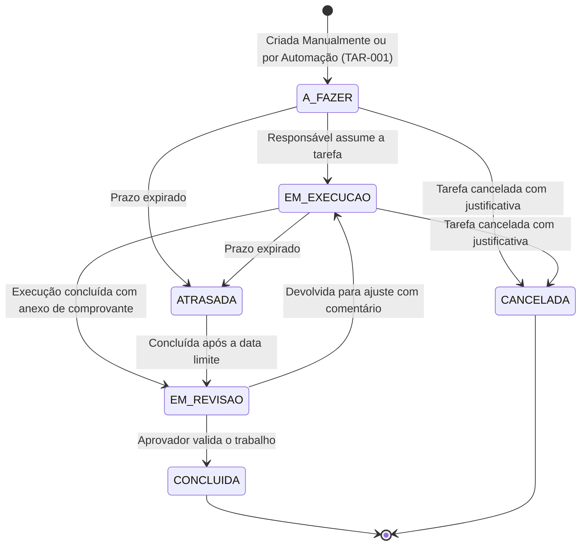
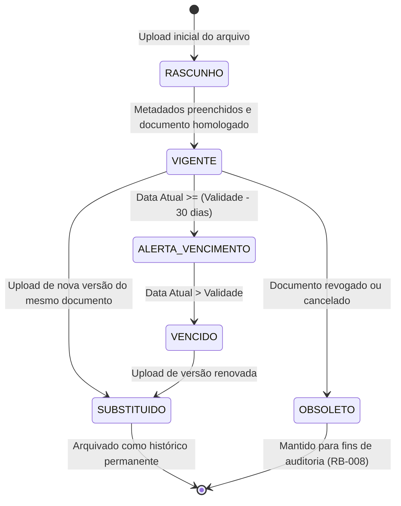

# LIRA AI: Plataforma de Gestão Ambiental SaaS
## Fase 1: Especificação Funcional Detalhada (Documento v0.2)
**Status:** Proposta de Refinamento para Aprovação  
**Versão:** v0.2 (Detalhamento do Core Compliance e Release 1.0)  
**Data:** 2026-10-21  

---

## 1. Definição do Escopo da Primeira Entrega Comercial (Release 1.0)

Para evitar sobrecarga de desenvolvimento e assegurar lançamento rápido com alto valor percebido (Princípio YAGNI / Lazy Senior Dev), o escopo da plataforma LIRA AI é distribuído em três ondas planejadas de entrega.



### 1.1 Justificativa da Priorização do Release 1.0
O maior risco e dor imediata de indústrias e consultorias ambientais é a **perda de prazos de renovação de licenças (multas e interdições operacionais)** e o **descumprimento de condicionantes ambientais**. Entregar um núcleo infalível de **Licenças + Condicionantes + Tarefas + Documentação Comprobatória + Alertas Automatizados** resolve 80% do valor de negócio com a menor superfície de complexidade.

---

## 2. Matriz de Perfis e Permissões (RBAC Granular)

O acesso ao sistema é regido por duas dimensões obrigatórias: **Escopo Organizacional (Tenant Scope)** e **Papel Funcional (Role)**.

### 2.1 Fronteiras de Confiança (Trust Boundaries)
1. **Tenant Isolation Boundary**: Nenhuma requisição transita sem validação do `organization_id` originado do token autenticado de sessão.
2. **Consultancy Scope Boundary**: Usuários de consultoria só herdam permissões sobre clientes que possuem vínculo ativo e vigente na tabela associativa `organization_clients`.
3. **Unit Delegation Boundary**: Usuários podem ter escopo restrito a unidades específicas (ex.: Analista alocado exclusivamente na "Unidade Fabril Paulínia").

### 2.2 Matriz de Autorização por Módulo (Release 1.0)

| Perfil | ORG (Org/Unidades) | LIC (Licenças) | CON (Condicionantes) | TAR (Tarefas) | DOC (Documentos) | IAI (Extração IA) | AUT (Alertas) |
| :--- | :---: | :---: | :---: | :---: | :---: | :---: | :---: |
| **Admin Plataforma (LIRA)** | Total (Cross-Tenant) | Apenas Suporte | Apenas Suporte | N/A | Auditoria | Suporte/Custos | Monitoramento |
| **Admin Organização** | Total no Tenant | CRUD Total | CRUD Total | CRUD Total | CRUD Total | Executar/Aprovar | Configurar Regras |
| **Gestor Ambiental** | Leitura/Unidades | CRUD Total | CRUD Total + Homologar | CRUD Total | CRUD Total | Executar/Aprovar | Configurar Prazos |
| **Consultor Ambiental** | Leitura Clientes Autorizados | Criar/Editar em Clientes | Criar/Editar + Submeter | CRUD Tarefas Atribuídas | Upload/Download | Executar/Revisar | Receber Alertas |
| **Analista Ambiental** | Leitura Unidades Vinculadas | Visualizar | Atualizar Status/Evidência | Executar Tarefas | Upload/Visualizar | Visualizar Sugestão | Receber Alertas |
| **Responsável Operacional** | Leitura Unidade Local | Visualizar | N/A | Executar Tarefas Locais | Anexar Comprovante | N/A | Receber Alertas |
| **Auditor / Revisor** | Leitura | Visualizar | Avaliar e Homologar | Visualizar/Comentar | Visualizar/Validar | Auditar Histórico | Receber Alertas |
| **Visualizador / Convidado** | Leitura Restrita | Visualizar (Sem Anexos Sensíveis) | Visualizar Resumo | Visualizar Resumo | Leitura Permitida | N/A | Não |

---

## 3. Máquinas de Estados Finitas (FSM)

Para evitar ambiguidades e regras inventadas durante o desenvolvimento, os quatro núcleos de dados do Release 1.0 operam sob máquinas de estado estritas com transições validadas por invariantes de negócio.

### 3.1 Ciclo de Vida da Licença Ambiental (LIC)



#### Invariantes da Licença:
- **INV-LIC-01**: Uma licença com status `VIGENTE` deve obrigatoriamente possuir um arquivo de evidência PDF anexado (`DOC-001`).
- **INV-LIC-02**: Se `data_validade - data_atual <= 120 dias`, o sistema ativa automaticamente o estado de atenção visual `ALERTA_RENOVACAO` (conforme LC 140/2011).
- **INV-LIC-03**: A transição para `EM_RENOVACAO` requer obrigatoriamente o preenchimento de: `numero_protocolo_orgao`, `data_protocolo` e arquivo PDF do comprovante protocolado. Enquanto em renovação tempestiva, a licença é considerada legalmente prorrogada até decisão do órgão ambiental.

---

### 3.2 Ciclo de Vida da Condicionante Ambiental (CON)



#### Invariantes da Condicionante:
- **INV-CON-01**: É expressamente proibida a transição direta de `PENDENTE` ou `EM_ANDAMENTO` para `ATENDIDA` sem passar por `AGUARDANDO_REVISAO` (princípio da dupla checagem / quatro-olhos).
- **INV-CON-02**: O sistema bloqueia a transição para `AGUARDANDO_REVISAO` se a contagem de documentos/evidências vinculados for zero (`RB-004`).
- **INV-CON-03**: Se o usuário que solicita o fechamento for o mesmo com perfil Gestor, o sistema exige declaração de autorrevisão e registra flag de auditoria simplificada.
- **INV-CON-04 (Condicionantes Recorrentes)**: Ao atingir o estado `ATENDIDA` em uma condicionante com regra de periodicidade (ex.: relatório semestral de monitoramento), o sistema cria automaticamente a próxima instância no estado `PENDENTE`, calculando a nova data limite com base na regra de recorrência (`AUT-005` e `AUT-006`).

---

### 3.3 Ciclo de Vida da Tarefa Operacional (TAR)



---

### 3.4 Ciclo de Vida da Gestão Documental (DOC)



---

## 4. Detalhamento dos Fluxos Operacionais Críticos (Release 1.0)

Abaixo estão detalhados os oito fluxos indispensáveis para a primeira entrega comercial.

---

### Fluxo 01: Cadastro de Organização e Unidades Operacionais (ORG)
- **Atores**: Administrador da Plataforma (para criação da conta contratante) ou Administrador da Organização (para cadastro de unidades).
- **Pré-condições**: Usuário autenticado com credenciais válidas e permissão administrativa.
- **Gatilho**: Nova contratação de plano ou expansão operacional da empresa para nova planta.

#### Fluxo Principal:
1. O usuário acessa **Configurações > Organização e Unidades**.
2. O sistema exibe o formulário solicitando:
   - Razão Social e Nome Fantasia.
   - CNPJ (com validação matemática obrigatória de dígitos verificadores) ou identificador internacional.
   - CNAE Principal (Classificação Nacional de Atividades Econômicas).
   - Endereço completo com coordenadas geográficas aproximadas (Latitude/Longitude).
   - E-mail corporativo de contato institucional.
3. O usuário clica em **Salvar Organização**. O sistema grava os dados com `organization_id` único gerado via UUIDv4.
4. O usuário clica em **Adicionar Unidade Operacional**.
5. O sistema solicita:
   - Nome identificador da unidade (ex.: "Planta Química 01 - Camaçari").
   - Tipo da unidade: Matriz, Filial, Depósito, Canteiro de Obras ou Frente Temporária.
   - CNPJ da unidade (caso possua filial específica) e Inscrição Estadual.
   - Endereço físico e bacia hidrográfica correspondente (quando aplicável).
6. O sistema valida os campos obrigatórios e registra a unidade vinculada à organização mãe.
7. O sistema gera log de auditoria (`RB-003`) e exibe a mensagem de sucesso.

#### Fluxos de Exceção:
- **E01 - CNPJ Inválido ou Duplicado**: O sistema rejeita o formulário com alerta em linha (`422 Unprocessable Entity`), impedindo a criação.
- **E02 - Limite do Plano Excedido**: Caso o plano contratado limite a empresa a 3 unidades e o usuário tente criar a quarta, o sistema bloqueia a ação informando a necessidade de upgrade comercial (`SaaS-005`).

---

### Fluxo 02: Cadastro de Consultoria e Vinculação de Cliente (ORG)
- **Atores**: Gestor da Consultoria Ambiental e Administrador da Empresa Cliente.
- **Pré-condições**: Ambas as organizações cadastradas na plataforma ou a consultoria criando um cliente sob sua gestão.
- **Gatilho**: Fechamento de contrato de assessoria e conformidade ambiental.

#### Fluxo Principal:
1. O Gestor da Consultoria acessa **Carteira de Clientes > Conectar Novo Cliente**.
2. O sistema disponibiliza duas opções de relacionamento:
   - *Opção A (Cliente já possui conta LIRA AI)*: Inserir CNPJ do cliente e enviar solicitação formal de vínculo de gestão técnica.
   - *Opção B (Cliente não possui conta)*: A consultoria cadastra o perfil do cliente como empresa gerida, preenchendo dados cadastrais e unidades aplicáveis.
3. Para a Opção A, o Administrador da Empresa Cliente recebe notificação in-app e e-mail com termo de compartilhamento de dados.
4. O Administrador do Cliente aprova o vínculo, selecionando quais unidades operacionais e módulos a consultoria terá acesso e definindo a data de vigência do contrato.
5. O sistema estabelece o registro associativo na tabela `organization_clients` com status `ATIVO` e timestamp de vigência.
6. A partir deste momento, os consultores autorizados visualizam o cliente em seu seletor de contexto superior (Tenant Switcher).

#### Fluxos de Exceção:
- **E01 - Contrato de Prestação Vencido**: Ao expirar a data de vigência sem renovação cadastrada, o sistema desativa silenciosamente o acesso do consultor aos dados do cliente, mantendo o histórico de ações já executadas (`RB-002`).

---

### Fluxo 03: Convite de Usuário e Gestão de Permissões (ORG)
- **Atores**: Administrador da Organização.
- **Pré-condições**: Organização com saldo de usuários disponíveis no plano contratado.
- **Gatilho**: Contratação de novo funcionário ou delegação de atribuições ambientais.

#### Fluxo Principal:
1. O Administrador acessa **Usuários e Permissões > Convidar Usuário**.
2. Informa: Nome Completo, E-mail Corporativo, Perfil de Acesso (conforme Seção 2) e Escopo de Unidades (Todas as unidades ou seleção restrita).
3. O sistema valida se o e-mail já não possui convite pendente e gera um token criptográfico temporário de convite com validade de 72 horas.
4. O sistema dispara e-mail formal contendo botão com link assinado para definição de senha.
5. O convidado clica no link, define sua senha de acordo com a política de segurança (mínimo 10 caracteres, letras maiúsculas, minúsculas, números e símbolos especiais).
6. O sistema ativa a conta do usuário, vincula-o à organização com o papel selecionado e registra o aceite dos Termos de Uso e Política de Privacidade (LGPD).

#### Fluxos de Exceção:
- **E01 - Convite Expirado**: Ao clicar após 72 horas, o sistema informa expiração e disponibiliza botão para reenvio pelo administrador.

---

### Fluxo 04: Cadastro de Licença Ambiental e Condicionantes (LIC e CON)
- **Atores**: Gestor Ambiental, Consultor Ambiental ou Analista Ambiental.
- **Pré-condições**: Unidade operacional cadastrada.
- **Gatilho**: Emissão de nova licença por órgão ambiental ou migração de acervo legador.

#### Fluxo Principal:
1. O usuário clica em **Licenças > Nova Licença**.
2. Preenche os dados obrigatórios:
   - Unidade / Empreendimento vinculado.
   - Órgão Ambiental Emissor (ex.: IBAMA, CETESB, INEA, IAT, SEMAD).
   - Tipo de Instrumento: LP (Prévia), LI (Instalação), LO (Operação), LAS (Simplificada), AAU, Outorga de Água ou Dispensa.
   - Número do Processo Administrativo e Número Oficial da Licença.
   - Data de Emissão e Data de Vencimento.
   - Descrição sumária do objeto licenciado.
3. Faz o upload obrigatório do arquivo PDF da licença digitalizada (`DOC-001`). O sistema armazena o arquivo, gera hash SHA-256 e armazena metadados de auditoria.
4. O sistema calcula automaticamente:
   - Data Limite de Renovação Tempestiva (`data_vencimento - 120 dias`).
   - Estado inicial: `VIGENTE` (se vencimento futuro) ou `VENCIDA` (se data retroativa).
5. Na aba **Condicionantes**, o usuário clica em **Adicionar Condicionante** (ou aciona o Assistente de IA, ver Fluxo 12).
6. Para cada condicionante, informa:
   - Número/Artigo da condicionante (ex.: "Condicionante 2.1").
   - Texto descritivo integral da exigência ambiental.
   - Tipo de prazo: Data Fixa, Prazo Contínuo ou Recorrente (Mensal, Trimestral, Semestral, Anual).
   - Responsável técnico pela execução.
   - Critério objetivo de atendimento (o que constitui evidência válida).
7. O usuário clica em **Salvar e Publicar**. O sistema cria as condicionantes no estado `PENDENTE` e agenda as notificações automáticas de monitoramento.

---

### Fluxo 05: Criação e Atribuição de Tarefa a partir de Obrigação (TAR e CON)
- **Atores**: Gestor Ambiental ou Consultor.
- **Pré-condições**: Condicionante cadastrada e vigente.
- **Gatilho**: Necessidade de desdobrar uma condicionante em atividades operacionais tangíveis (ex.: contratar laboratório de análise de efluentes).

#### Fluxo Principal:
1. O usuário abre o detalhe da Condicionante e clica em **Nova Tarefa Operacional**.
2. O sistema pré-vincula automaticamente a tarefa à Condicionante, Licença e Unidade correspondente.
3. O usuário define:
   - Título da tarefa (ex.: "Realizar amostragem trimestral do Ponto de Lançamento E-01").
   - Descrição detalhada dos procedimentos exigidos.
   - Usuário ou Equipe Responsável pela execução.
   - Prazo Fatal (obrigatoriamente anterior ou igual ao prazo final da condicionante).
   - Nível de prioridade (Baixa, Média, Alta, Crítica).
4. O sistema grava a tarefa com status inicial `A_FAZER` (`TAR-005`).
5. O responsável designado recebe notificação in-app e e-mail com a atribuição e prazo.

---

### Fluxo 06: Execução de Tarefa com Anexação de Evidências (TAR e DOC)
- **Atores**: Analista Ambiental ou Responsável Operacional.
- **Pré-condições**: Tarefa atribuída ao usuário com status `A_FAZER` ou `EM_EXECUCAO`.
- **Gatilho**: Realização do serviço em campo ou recepção do laudo técnico do fornecedor.

#### Fluxo Principal:
1. O responsável abre a tarefa através do seu painel "Minhas Tarefas" ou lista de tarefas da unidade.
2. Clica em **Iniciar Execução** (o status transita para `EM_EXECUCAO`).
3. Após execução do procedimento, clica em **Anexar Evidências**.
4. Seleciona o arquivo (ex.: laudo laboratorial em PDF, relatório técnico de medição ou fotos do local com carimbo de data).
5. Preenche os metadados do documento: título, data de emissão, laboratório/autor responsável e anotações técnicas complementares.
6. Clica em **Concluir Tarefa e Submeter para Revisão**.
7. O status da tarefa avança para `EM_REVISAO` e o Gestor/Aprovador da condicionante é notificado.

#### Fluxos de Exceção:
- **E01 - Tentativa de conclusão sem anexar evidência**: O sistema emite alerta impeditivo: *"Não é possível concluir a tarefa sem anexar ao menos um documento ou evidência comprobatória (RB-004)"*.

---

### Fluxo 07: Revisão e Homologação de Atendimento de Condicionante (CON e RB-006)
- **Atores**: Gestor Ambiental, Auditor Técnico ou Consultor Líder.
- **Pré-condições**: Condicionante no estado `AGUARDANDO_REVISAO` com evidências anexadas.
- **Gatilho**: Notificação de submissão de atendimento pelo executor.

#### Fluxo Principal:
1. O Gestor acessa **Condicionantes > Fila de Homologação**.
2. Abre a condicionante em análise e inspeciona:
   - Texto original e prazo da exigência.
   - Tarefas operacionais executadas.
   - Documentos e laudos laboratoriais anexados (abre o visualizador integrado de PDF).
3. O Gestor avalia se os parâmetros técnicos atendem rigorosamente à legislação e aos padrões do órgão emissor.
4. **Cenário de Aprovação**:
   - O Gestor clica em **Homologar Atendimento**.
   - O sistema solicita confirmação com parecer técnico de encerramento.
   - O status da condicionante transita para `ATENDIDA`.
   - Se for uma condicionante periódica, o sistema cria automaticamente o próximo ciclo no estado `PENDENTE` (`AUT-005`).
5. O sistema grava o log auditável com `user_id` do aprovador, data/hora e parecer formal (`RB-003`).

#### Fluxo Alternativo (Rejeição ou Devolução para Ajuste):
1. O Gestor identifica que o laudo laboratorial carece de parâmetro mandatório (ex.: falta DBO ou DQO no laudo de efluentes).
2. O Gestor clica em **Devolver para Ajuste**.
3. Preenche obrigatoriamente a justificativa técnica apontando a não conformidade encontrada.
4. O status da condicionante retorna para `EM_ANDAMENTO`. O executor da tarefa é alertado imediatamente sobre a devolução.

---

### Fluxo 12: Extração Assistida por IA com Revisão Humana Obrigatória (IAI e RB-009)
- **Atores**: Gestor Ambiental ou Consultor Técnico.
- **Pré-condições**: Arquivo PDF pesquisável de licença ambiental emitido por órgão oficial.
- **Gatilho**: Cadastro de licença complexa com extenso rol de condicionantes (ex.: 40 condicionantes técnicas).

#### Fluxo Principal:
1. Na tela de cadastro de licença, o usuário seleciona **Importar via Assistente IA (LIRA Extract)** e faz o upload do arquivo PDF.
2. O sistema envia o documento para o pipeline de processamento em sandbox segura (`IAI-001` / `RNF-002`).
3. O pipeline de IA realiza:
   - Extração estruturada dos metadados da licença (Órgão, Número, Vigência, Empreendimento).
   - Segmentação e detecção de cláusulas de condicionantes e restrições.
   - Identificação de prazos explícitos ou tácitos vinculados a cada condicionante.
4. O sistema apresenta uma tela de **Revisão Lado a Lado (Split Screen)**:
   - *Painel Esquerdo*: Visualizador do PDF oficial da licença, com as páginas destacadas onde o texto foi identificado.
   - *Painel Direito*: Grade de registros propostos pela IA, cada um com status visual "Sugestão da IA (Pendente de Validação)".
5. Para cada sugestão, o usuário clica sobre ela. O visualizador no painel esquerdo desloca-se automaticamente para o trecho/página exata de origem no PDF (`IAI-007` - Grounding).
6. O usuário pode:
   - **Aceitar**: Confirma a extração. O registro torna-se oficial.
   - **Editar**: Ajusta o texto, corrige o prazo ou altera o responsável técnico.
   - **Descartar**: Remove cláusulas meramente informativas ou considerações preliminares que a IA tenha classificado incorretamente como condicionante.
7. Após revisar todos os itens, o usuário clica em **Finalizar e Salvar Licença Homologada**.
8. O sistema cria os registros oficiais com flag `revisado_por_humano = true` e grava a métrica de acurácia da extração para monitoramento de qualidade (`IAI-009`).

---

## 5. Critérios de Aceitação Verificáveis (BDD / Gherkin)

Abaixo estão formalizados os cenários de teste automatizados para as principais regras de negócio do Release 1.0.

### Cenário 01: Isolamento Multitenant (RB-001)
```gherkin
Cenário: Usuário tenta acessar licença de outra organização via manipulação de ID
  Dado que o usuário "analista@empresa-a.com.br" está autenticado na "Empresa A"
  E existe uma licença "LIC-999" pertencente exclusivamente à "Empresa B"
  Quando o usuário envia uma requisição GET para "/api/v1/licenses/LIC-999"
  Então o sistema deve retornar o código de status HTTP 404 Not Found
  E nenhuma informação ou metadado da "Empresa B" deve ser vazado na resposta
  E um registro de tentativa de acesso não autorizado deve ser gravado no log de segurança
```

### Cenário 02: Transição de Estado e Regra de Renovação dos 120 Dias (LIC e RB-005)
```gherkin
Cenário: Licença atinge o prazo legal de 120 dias para renovação tempestiva
  Dado que existe uma licença com data de validade para "2026-12-01"
  E a data atual do sistema avança para "2026-08-03" (120 dias antes do vencimento)
  Quando o job de verificação de prazos diário é executado
  Então o status da licença deve transitar de "VIGENTE" para "ALERTA_RENOVACAO"
  E uma notificação de alta prioridade deve ser enviada para o Gestor Ambiental responsável
  E a licença deve ser exibida com badge visual amarelo no painel de conformidade
```

### Cenário 03: Bloqueio de Conclusão de Condicionante sem Evidência (CON e RB-004)
```gherkin
Cenário: Analista tenta submeter condicionante para aprovação sem anexar arquivo
  Dado que a condicionante "CON-042" está com status "EM_ANDAMENTO"
  E não há nenhum documento ou imagem vinculado a esta condicionante
  Quando o usuário aciona o comando "Submeter para Revisão"
  Então a transição de estado deve ser rejeitada com código 422 Unprocessable Entity
  E a mensagem "É obrigatório anexar ao menos uma evidência comprobatória antes de submeter" deve ser exibida
  E o status da condicionante deve permanecer "EM_ANDAMENTO"
```

### Cenário 04: Segregação de Funções / Aprovação por Quatro-Olhos (CON e RB-006)
```gherkin
Cenário: Analista que executou a tarefa tenta homologar a própria condicionante
  Dado que o usuário "carlos@empresa.com" possui o papel de "Analista Ambiental"
  E o usuário "carlos@empresa.com" submeteu o atendimento da condicionante "CON-010"
  Quando o usuário "carlos@empresa.com" envia comando de "Homologar Atendimento"
  Então o sistema deve recusar a operação com código 403 Forbidden
  E informar que a homologação exige permissão de Gestor Ambiental ou Revisor independente
```

### Cenário 05: Extração de IA sem Aprovação Humana (IAI e RB-009)
```gherkin
Cenário: Sugestão de IA não pode gerar condicionante oficial ativa sem revisão humana
  Dado que o pipeline de IA extraiu 15 condicionantes de um PDF
  Quando as condicionantes estão no estado "Sugestão da IA"
  Então elas não devem ser contabilizadas nos indicadores oficiais de conformidade
  E nenhuma tarefa operacional deve ser gerada automaticamente antes da homologação
  E o sistema só deve persistir os registros como oficiais após o clique explícito de aprovação do usuário
```

---

## 6. Análise e Resoluções Recomendadas para as 10 Decisões Pendentes

Com base no princípio da máxima simplicidade e menor esforço viável (Ponytail / Lazy Senior Dev), apresentamos a recomendação técnica para cada uma das dez decisões pendentes do Documento v0.1:

| ID | Decisão Pendente | Opções Avaliadas | Decisão Aprovada / Recomendada | Racional Técnico e YAGNI | Status |
| :--- | :--- | :--- | :--- | :--- | :---: |
| **D-01** | **Segmentos e Estados Prioritários** | 1. Todos os estados brasileiros.<br>2. SP, RJ, MG e PR.<br>3. Estrutura genérica extensível. | **Opção 3: Estrutura genérica de órgãos ambientais**, pré-carregada com os principais federais e estaduais (IBAMA, CETESB, INEA, IAT, SEMAD). | Evita hardcode de dezenas de legislações locais e permite que qualquer empresa cadastre seu órgão municipal ou estadual sem travas de código. | Proposta |
| **D-02** | **Modelo de Vínculo Consultoria x Cliente** | 1. Tenant independente para cada um.<br>2. Consultoria cria clientes como pastas internas.<br>3. Modelo híbrido com convite. | **Opção 3: Modelo Híbrido.** Clientes pequenos podem ser criados como 'Pastas de Clientes' pela consultoria; clientes corporativos criam sua própria conta e convidam a consultoria. | Dá flexibilidade comercial imediata: a consultoria não perde negócios com clientes que não querem assinar o SaaS diretamente. | **Aprovada** |
| **D-03** | **Escopo do 1º Lançamento** | 1. Todos os 14 módulos.<br>2. Apenas Licenças.<br>3. Core Compliance (ORG, LIC, CON, TAR, DOC, IAI básico). | **Opção 3: Core Compliance.** (Detalhado no Capítulo 1 deste documento: ORG, LIC, CON, TAR, DOC, IA Piloto, Alertas e SaaS Básico). | Entrega um produto comercial completo e vendável sem o custo de desenvolvimento de resíduos e auditorias completas no dia 1. | **Aprovada** |
| **D-04** | **Cobertura de Normas Legais** | 1. Scraping automático de diários oficiais.<br>2. Assinatura de base terceirizada paga.<br>3. Cadastro sob demanda por clientes/consultores com biblioteca compartilhada. | **Opção 3: Cadastro sob demanda com curadoria compartilhada** na base LIRA. | Scraping de diários oficiais tem manutenção proibitiva e instável no MVP. A biblioteca colaborativa atende com precisão cirúrgica. | Proposta |
| **D-05** | **Fluxo Quatro-Olhos Obrigatório** | 1. Obrigatório e rígido para todos.<br>2. Opcional/configurável por organização. | **Opção 2: Configurável por Organização.** Padrão: ativado para empresas com mais de 3 usuários; desativado para usuários solo. | Não engessa consultores individuais ou pequenas empresas que possuem apenas um responsável técnico ambiental. | Proposta |
| **D-06** | **Operação Offline para Inspeções** | 1. Offline nativo com PWA e IndexedDB.<br>2. Online-first responsivo com auto-save em caso de queda. | **Opção 2: Online-first responsivo para Release 1.0.** Adiar sincronização bidirecional complexa para o Release 2.0 (módulo INS). | Sincronização offline-first adiciona complexidade de resolução de conflitos desnecessária ao Core Compliance de licenças. | Proposta |
| **D-07** | **Planos e Métricas de Cobrança** | 1. Por usuário ativo.<br>2. Por volume de licenças gerenciadas.<br>3. Por Unidade Operacional / Empresa Gerida. | **Opção 3: Por Unidade / Carteira de Clientes**, com usuários ilimitados ou faixas generosas. | Clientes preferem envolver todos os colaboradores sem medo de pagar por usuário extra; o valor ambiental está atrelado às plantas físicas geridas. | Proposta |
| **D-08** | **Retenção de Dados Pós-Cancelamento** | 1. Exclusão imediata.<br>2. 30 dias de carência para exportação, seguido de arquivamento seguro por 12 meses. | **Opção 2: 30 dias de carência com botão de exportação completa (ZIP + JSON/Excel)**, seguido de cold storage. | Atende plenamente à LGPD e protege juridicamente a LIRA AI contra acusações de destruição indevida de histórico regulatório. | Proposta |
| **D-09** | **Provedor e Arquitetura de IA** | 1. OpenAI ChatGPT API.<br>2. Modelos Google Gemini via Vertex AI com residência de dados no Brasil e zero retention.<br>3. Modelo open-source auto-hospedado. | **Opção 2: Google Gemini via Vertex AI.** | Excelente relação custo-benefício para documentos em PDF de grande extensão (context window amplo), suporte nativo a OCR e conformidade com LGPD. |
| **D-10** | **Integrações com Órgãos Governamentais** | 1. Integração com SINIR/SIGOR e webscraping de órgãos estaduais.<br>2. Upload manual de protocolos e licenças digitais via PDF. | **Opção 2: Upload manual com extração inteligente via IA no Release 1.0.** | Integrações públicas no Brasil mudam layouts e CAPTCHAs frequentemente sem aviso, tornando o MVP frágil se depender delas. |

---

## 7. Diretrizes de UI/UX Integradas (Design System LIRA AI)

Com base nas diretrizes do `ui-ux-pro-max` persistidas no [MASTER.md](file:///c:/Users/04680566108/Documents/lira-ai/design-system/lira-ai/MASTER.md), a interface do LIRA AI adota o padrão **Trust and Authority** com arquitetura **Enterprise Gateway**.

### 7.1 Fundamentos Visuais
- **Tipografia**: `Plus Jakarta Sans` para títulos e corpo de texto (alta legibilidade, profissionalismo SaaS).
- **Paleta de Cores Institucional**:
  - `Primary`: `#0F172A` (Slate 900: autoridade, contraste e sobriedade).
  - `Secondary`: `#334155` (Slate 700: textos auxiliares, bordas estruturais).
  - `CTA / Destaque`: `#0369A1` (Blue 700: ações afirmativas, links principais, botões primários).
  - `Background`: `#F8FAFC` (Slate 50: fundo limpo, descanso visual e contraste elevado).
  - `Text`: `#020617` (Slate 950: legibilidade máxima, taxa de contraste > 7:1, atendendo WCAG AAA).

### 7.2 Semântica Visual de Status de Conformidade
Para evitar confusão cognitiva nos painéis operacionais, as cores de status seguem estritamente convenções internacionais de segurança:
- **Conformidade Regular / Vigente / Atendida**: Fundo `#ECFDF5`, Texto/Borda `#059669` (Emerald).
- **Alerta / Atenção de Prazos (30 a 120 dias)**: Fundo `#FFFBEB`, Texto/Borda `#D97706` (Amber).
- **Crítico / Vencido / Em Atraso**: Fundo `#FEF2F2`, Texto/Borda `#DC2626` (Red).
- **Sugestão de IA / Aguardando Revisão**: Fundo `#EFF6FF`, Texto/Borda `#2563EB` (Blue com ícone de centelha SVG).
- **Inativo / Rascunho / Obsoleto**: Fundo `#F1F5F9`, Texto/Borda `#64748B` (Slate neutro).

### 7.3 Regras de Usabilidade e Anti-Patterns Mandatórios
- **Proibição de Emojis como Ícones de Interface**: É expressamente proibido o uso de emojis (como 🚀, ⚠️, 📄, ⚙️) para sinalizar estados do sistema. Utilizar exclusivamente ícones SVG padronizados (Lucide ou Heroicons).
- **Cursores e Microinterações**: Todo componente clicável deve conter `cursor-pointer` explícito e transições suaves de 150ms a 200ms (`transition: all 200ms ease`), sem efeitos bruscos de layout shift.
- **Prevenção de Erros Operacionais**: Formulários com alterações não salvas devem exibir modal de confirmação caso o usuário tente sair da página.
- **Acessibilidade Universal**: Navegação funcional 100% por teclado (`Tab`, `Shift+Tab`, `Enter`, `Esc`) e foco visível demarcado (`focus-visible: ring-2 ring-primary`).

---

## 8. Checklist de Prontidão da Fase 1

- [x] Escopo do Release 1.0 (Core Compliance) formalmente delimitado.
- [x] Matriz de Perfis e Permissões (RBAC) com trust boundaries detalhada.
- [x] Máquinas de Estados Finitas (FSM) de Licenças, Condicionantes, Tarefas e Documentos modeladas.
- [x] Fluxos operacionais críticos detalhados passo a passo (com pré-condições, exceções e pós-condições).
- [x] Critérios de aceitação verificáveis escritos no padrão BDD/Gherkin.
- [x] Resoluções e recomendações técnicas para as 10 decisões pendentes formalizadas.
- [x] Padrões de UI/UX, tokens visuais e semântica de conformidade integrados.
