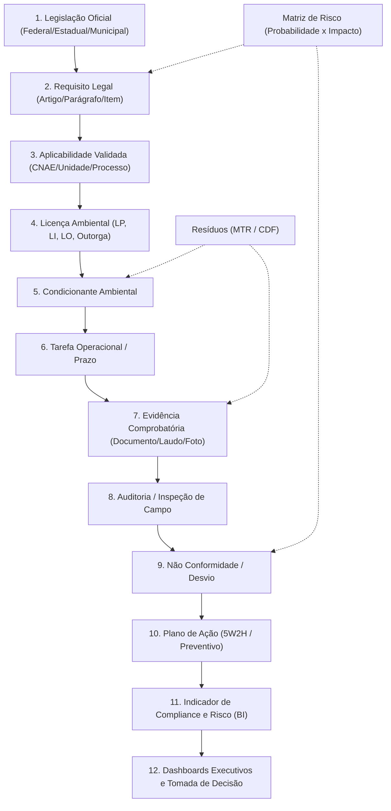
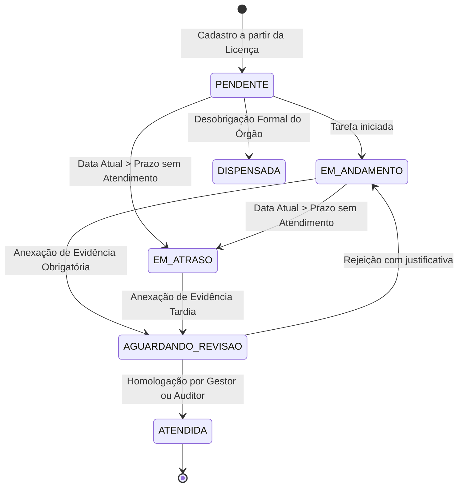

# LIRA AI — Especificação Técnica de Desenvolvimento (v1.0)
## Plataforma SaaS de Gestão Ambiental, Compliance Legal e Operações Ambientais

**Status:** Aprovado para Implementação e Execução por Agente  
**Versão:** 1.0.0  
**Data:** 2026-10-21  
**Padrão de Engenharia:** Lazy Senior Dev (Ponytail Mindset) — YAGNI absoluto, segurança inegociável em trust boundaries, clean diffs e prontidão para CodeRabbit.

---

## SUMÁRIO EXECUTIVO

1. [Conceito Arquitetural e o Grafo de Conformidade](#1-conceito-arquitetural-e-o-grafo-de-conformidade)
2. [Arquitetura Geral: Monólito Modular](#2-arquitetura-geral-monólito-modular)
3. [Modelo de Dados Relacional e DDL PostgreSQL Completo](#3-modelo-de-dados-relacional-e-ddl-postgresql-completo)
4. [Contratos de API REST](#4-contratos-de-api-rest)
5. [Regras de Negócio, Invariantes e Máquinas de Estado (FSM)](#5-regras-de-negócio-invariantes-e-máquinas-de-estado-fsm)
6. [Matriz de Permissões Granular (RBAC) e Trust Boundaries](#6-matriz-de-permissões-granular-rbac-e-trust-boundaries)
7. [Estrutura de Telas, Navegação e Frontend](#7-estrutura-de-telas-navegação-e-frontend)
8. [Fluxos de Usuário Críticos](#8-fluxos-de-usuário-críticos)
9. [Backlog Executável para Agente de Programação (Epics 01 a 27)](#9-backlog-executável-para-agente-de-programação-epics-01-a-27)

---

## 1. CONCEITO ARQUITETURAL E O GRAFO DE CONFORMIDADE

### 1.1 O Diferencial Central: O Grafo de Conformidade Ambiental
Diferente de sistemas legados que operam como silos isolados (uma planilha de licenças separada de uma lista de leis e de um controle de resíduos), o **LIRA AI** é modelado como um **Grafo Direcionado de Governança Ambiental**.

Toda obrigação e operação é um nó conectado:



### 1.2 Multiempresa + Multiunidade + Multicliente
A arquitetura atende simultaneamente dois perfis nativos:
- **Perfil A (Empresas)**: Uma organização com sua própria estrutura de matriz, filiais, plantas industriais, obras e canteiros.
- **Perfil B (Consultorias Ambientais)**: Uma organização gestora que administra dezenas ou centenas de clientes com isolamento estrito de dados, permitindo visão consolidada para o consultor líder e visão restrita para o cliente contratante.

```
Organização (Tenant)
├── Usuários & Perfis (RBAC Granular)
├── Clientes Vinculados (Consultancy ↔ Managed Client)
├── Unidades Operacionais (Plantas, Fazendas, Minas, Canteiros)
│   ├── Georreferenciamento (Coordenadas, Polígonos, Município, Bacia)
│   ├── Licenças Ambientais & Processos
│   ├── Condicionantes & Prazos
│   ├── Requisitos Legais Aplicáveis
│   ├── Gestão de Resíduos (Geração, MTR, CDF)
│   ├── Inspeções de Campo & Checklists Offline
│   ├── Matriz de Riscos Operacionais
│   └── Projetos Ambientais
└── Repositório Transversal de Evidências, Fornecedores e Auditorias
```

---

## 2. ARQUITETURA GERAL: MONÓLITO MODULAR

Para viabilizar velocidade extrema de entrega, custos operacionais mínimos e consistência transacional sem a complexidade prematura de dezenas de microsserviços (seguindo a filosofia Ponytail / Lazy Senior Dev), o backend adota uma arquitetura de **Monólito Modular** com separação explícita de contextos delimitados (*Bounded Contexts*):

```
┌────────────────────────────────────────────────────────────────────────┐
│                        NEXT.JS 16+ APP ROUTER                         │
│   (Server Components + Client Dashboards + PWA Offline Checklists)    │
└───────────────────────────────────┬────────────────────────────────────┘
                                    │ HTTPS / REST / SSE
┌───────────────────────────────────▼────────────────────────────────────┐
│                       MODULAR MONOLITH CORE (API)                      │
│ ┌───────────────┐ ┌────────────────┐ ┌────────────────┐ ┌────────────┐ │
│ │ Auth & RBAC   │ │ Compliance     │ │ Licenciamento  │ │ Operações  │ │
│ │ (Multi-Tenant)│ │ (Legislação/Req│ │ (Licença/Cond) │ │ (Tarefas)  │ │
│ └───────────────┘ └────────────────┘ └────────────────┘ └────────────┘ │
│ ┌───────────────┐ ┌────────────────┐ ┌────────────────┐ ┌────────────┐ │
│ │ Resíduos      │ │ Inspeções/Campo│ │ Auditorias/NC  │ │ Documentos │ │
│ │ (MTR/CDF)     │ │ (Sync Offline) │ │ (Planos Ação)  │ │ (Evidência)│ │
│ └───────────────┘ └────────────────┘ └────────────────┘ └────────────┘ │
│ ┌────────────────────────────────────────────────────────────────────┐ │
│ │       LIRA EVENT BUS (In-Memory / Redis Streams Decoupled)         │ │
│ └────────────────────────────────────────────────────────────────────┘ │
└───────────────────────────────────┬────────────────────────────────────┘
                                    │
           ┌────────────────────────┼────────────────────────┐
           ▼                        ▼                        ▼
┌────────────────────┐   ┌────────────────────┐   ┌──────────────────────┐
│  PostgreSQL 16+    │   │  Redis 7+          │   │  Storage S3 / R2     │
│  (RLS Multi-Tenant │   │  (Cache de Sessão, │   │  (Documentos, PDFs,  │
│   + Full Text + GIS│   │   Fila BullMQ,     │   │   Fotos e Evidências │
│   + JSONB Indexes) │   │   Lock Otimista)   │   │   com Assinatura)    │
└────────────────────┘   └────────────────────┘   └──────────────────────┘
           ▲
           │ Workers & Background Jobs
┌──────────┴─────────────────────────────────────────────────────────────┐
│                       ASYNC ENGINE & AI WORKERS                        │
│ ├── Motor de Prazos & Alertas Regressivos (120/90/60/30/15/7/1 dias)   │
│ ├── LIRA Extract (Parser de Licenças via AI Gateway)                   │
│ ├── LIRA Legal Watch (Crawler & Classificação de Diários Oficiais)     │
│ └── LIRA Sync (Processamento em Lote de Inspeções Offline)             │
└────────────────────────────────────────────────────────────────────────┘
```

---

## 3. MODELO DE DADOS RELACIONAL E DDL POSTGRESQL COMPLETO

O banco de dados utiliza **PostgreSQL 16+** com **Row-Level Security (RLS)** para garantia criptográfica/política de isolamento multilocatário no kernel do banco de dados, protegendo contra vazamento acidental de dados entre clientes.

### 3.1 DDL Completo das Tabelas Nucleares

```sql
-- Extensões necessárias
CREATE EXTENSION IF NOT EXISTS "uuid-ossp";
CREATE EXTENSION IF NOT EXISTS "citext";
CREATE EXTENSION IF NOT EXISTS "pgcrypto";

-- ============================================================================
-- 1. TENANTS, AUTENTICAÇÃO E RBAC
-- ============================================================================

CREATE TYPE organization_type AS ENUM ('ENTERPRISE', 'CONSULTANCY', 'MANAGED_CLIENT');
CREATE TYPE organization_status AS ENUM ('TRIAL', 'ACTIVE', 'SUSPENDED', 'CANCELLED');

CREATE TABLE organizations (
    id UUID PRIMARY KEY DEFAULT gen_random_uuid(),
    legal_name VARCHAR(255) NOT NULL,
    trade_name VARCHAR(255) NOT NULL,
    national_id VARCHAR(20) NOT NULL UNIQUE, -- CNPJ
    cnae_primary VARCHAR(10) NULL,
    cnae_secondary TEXT[] DEFAULT '{}',
    segment VARCHAR(100) NULL,
    company_size VARCHAR(50) NULL, -- MEI, ME, EPP, MEDIO, GRANDE
    economic_group VARCHAR(150) NULL,
    type organization_type NOT NULL DEFAULT 'ENTERPRISE',
    status organization_status NOT NULL DEFAULT 'ACTIVE',
    settings JSONB NOT NULL DEFAULT '{"four_eyes_approval": true, "renewal_alert_days": [120, 90, 60, 30, 15, 7, 1]}',
    created_at TIMESTAMPTZ NOT NULL DEFAULT clock_timestamp(),
    updated_at TIMESTAMPTZ NOT NULL DEFAULT clock_timestamp(),
    deleted_at TIMESTAMPTZ NULL
);

CREATE TABLE organization_clients (
    id UUID PRIMARY KEY DEFAULT gen_random_uuid(),
    consultancy_org_id UUID NOT NULL REFERENCES organizations(id) ON DELETE RESTRICT,
    client_org_id UUID NOT NULL REFERENCES organizations(id) ON DELETE RESTRICT,
    relationship_status VARCHAR(50) NOT NULL DEFAULT 'ACTIVE',
    authorized_modules JSONB NOT NULL DEFAULT '["COMPLIANCE", "LICENSING", "OPERATIONS", "WASTE", "DOCUMENTS"]',
    contract_valid_until DATE NULL,
    created_at TIMESTAMPTZ NOT NULL DEFAULT clock_timestamp(),
    updated_at TIMESTAMPTZ NOT NULL DEFAULT clock_timestamp(),
    CONSTRAINT uq_consultancy_client UNIQUE(consultancy_org_id, client_org_id)
);

CREATE TABLE users (
    id UUID PRIMARY KEY DEFAULT gen_random_uuid(),
    email CITEXT NOT NULL UNIQUE,
    password_hash VARCHAR(255) NOT NULL,
    full_name VARCHAR(255) NOT NULL,
    phone VARCHAR(30) NULL,
    is_superadmin BOOLEAN NOT NULL DEFAULT FALSE,
    mfa_enabled BOOLEAN NOT NULL DEFAULT FALSE,
    mfa_secret VARCHAR(255) NULL,
    status VARCHAR(50) NOT NULL DEFAULT 'ACTIVE',
    created_at TIMESTAMPTZ NOT NULL DEFAULT clock_timestamp(),
    updated_at TIMESTAMPTZ NOT NULL DEFAULT clock_timestamp(),
    deleted_at TIMESTAMPTZ NULL
);

CREATE TABLE roles (
    id UUID PRIMARY KEY DEFAULT gen_random_uuid(),
    name VARCHAR(50) NOT NULL UNIQUE, -- SUPER_ADMIN, ORG_ADMIN, ENVIRONMENTAL_MANAGER, ENVIRONMENTAL_ANALYST, AUDITOR, FIELD_OPERATOR, CLIENT_VIEWER
    description TEXT NULL,
    is_system BOOLEAN NOT NULL DEFAULT TRUE
);

CREATE TABLE permissions (
    id UUID PRIMARY KEY DEFAULT gen_random_uuid(),
    module VARCHAR(50) NOT NULL, -- LICENSES, CONDITIONS, REQUIREMENTS, DOCUMENTS, etc.
    action VARCHAR(50) NOT NULL, -- READ, CREATE, UPDATE, DELETE, APPROVE, EXPORT
    description TEXT NULL,
    CONSTRAINT uq_perm_module_action UNIQUE(module, action)
);

CREATE TABLE role_permissions (
    role_id UUID NOT NULL REFERENCES roles(id) ON DELETE CASCADE,
    permission_id UUID NOT NULL REFERENCES permissions(id) ON DELETE CASCADE,
    PRIMARY KEY(role_id, permission_id)
);

CREATE TABLE user_memberships (
    id UUID PRIMARY KEY DEFAULT gen_random_uuid(),
    user_id UUID NOT NULL REFERENCES users(id) ON DELETE CASCADE,
    organization_id UUID NOT NULL REFERENCES organizations(id) ON DELETE CASCADE,
    role_id UUID NOT NULL REFERENCES roles(id) ON DELETE RESTRICT,
    is_active BOOLEAN NOT NULL DEFAULT TRUE,
    created_at TIMESTAMPTZ NOT NULL DEFAULT clock_timestamp(),
    CONSTRAINT uq_user_org UNIQUE(user_id, organization_id)
);

-- ============================================================================
-- 2. UNIDADES OPERACIONAIS E GEORREFERENCIAMENTO
-- ============================================================================

CREATE TYPE unit_type AS ENUM ('HEADQUARTERS', 'BRANCH', 'INDUSTRIAL_PLANT', 'CONSTRUCTION_SITE', 'LOGISTICS_HUB', 'RURAL_PROPERTY', 'MINING_SITE');
CREATE TYPE unit_operational_status AS ENUM ('PLANNING', 'INSTALLATION', 'OPERATING', 'DECOMMISSIONING', 'SUSPENDED');

CREATE TABLE units (
    id UUID PRIMARY KEY DEFAULT gen_random_uuid(),
    organization_id UUID NOT NULL REFERENCES organizations(id) ON DELETE RESTRICT,
    name VARCHAR(255) NOT NULL,
    internal_code VARCHAR(50) NULL,
    national_id VARCHAR(20) NULL, -- CNPJ filial
    unit_type unit_type NOT NULL DEFAULT 'INDUSTRIAL_PLANT',
    operational_status unit_operational_status NOT NULL DEFAULT 'OPERATING',
    state CHAR(2) NOT NULL,
    city VARCHAR(100) NOT NULL,
    address TEXT NULL,
    hydrographic_basin VARCHAR(150) NULL,
    cnaes TEXT[] DEFAULT '{}',
    total_area_hectares NUMERIC(12, 4) NULL,
    latitude NUMERIC(10, 7) NULL,
    longitude NUMERIC(10, 7) NULL,
    area_polygon_geojson JSONB NULL,
    created_at TIMESTAMPTZ NOT NULL DEFAULT clock_timestamp(),
    updated_at TIMESTAMPTZ NOT NULL DEFAULT clock_timestamp(),
    deleted_at TIMESTAMPTZ NULL
);

CREATE TABLE user_unit_scopes (
    user_id UUID NOT NULL REFERENCES users(id) ON DELETE CASCADE,
    unit_id UUID NOT NULL REFERENCES units(id) ON DELETE CASCADE,
    PRIMARY KEY(user_id, unit_id)
);

-- ============================================================================
-- 3. DOCUMENTOS E REPOSITÓRIO IMUTÁVEL DE EVIDÊNCIAS
-- ============================================================================

CREATE TABLE documents (
    id UUID PRIMARY KEY DEFAULT gen_random_uuid(),
    organization_id UUID NOT NULL REFERENCES organizations(id) ON DELETE RESTRICT,
    unit_id UUID NULL REFERENCES units(id) ON DELETE SET NULL,
    title VARCHAR(255) NOT NULL,
    category VARCHAR(50) NOT NULL, -- LICENCA, LAUDO, RELATORIO, PROTOCOLO, CERTIFICADO, MTR, CDF, CONTRATO, FOTO, OUTROS
    status VARCHAR(50) NOT NULL DEFAULT 'ACTIVE',
    storage_key VARCHAR(500) NOT NULL,
    file_name VARCHAR(255) NOT NULL,
    file_size_bytes BIGINT NOT NULL,
    content_type VARCHAR(100) NOT NULL,
    sha256_hash VARCHAR(64) NOT NULL,
    issue_date DATE NULL,
    expiration_date DATE NULL,
    tags TEXT[] DEFAULT '{}',
    metadata JSONB NOT NULL DEFAULT '{}',
    uploaded_by UUID NOT NULL REFERENCES users(id),
    created_at TIMESTAMPTZ NOT NULL DEFAULT clock_timestamp(),
    updated_at TIMESTAMPTZ NOT NULL DEFAULT clock_timestamp(),
    deleted_at TIMESTAMPTZ NULL
);

CREATE TABLE document_versions (
    id UUID PRIMARY KEY DEFAULT gen_random_uuid(),
    document_id UUID NOT NULL REFERENCES documents(id) ON DELETE CASCADE,
    version_number INT NOT NULL,
    storage_key VARCHAR(500) NOT NULL,
    file_size_bytes BIGINT NOT NULL,
    sha256_hash VARCHAR(64) NOT NULL,
    change_reason TEXT NOT NULL,
    created_by UUID NOT NULL REFERENCES users(id),
    created_at TIMESTAMPTZ NOT NULL DEFAULT clock_timestamp(),
    CONSTRAINT uq_doc_version UNIQUE(document_id, version_number)
);

CREATE TABLE evidence_attachments (
    id UUID PRIMARY KEY DEFAULT gen_random_uuid(),
    organization_id UUID NOT NULL REFERENCES organizations(id) ON DELETE RESTRICT,
    document_id UUID NOT NULL REFERENCES documents(id) ON DELETE RESTRICT,
    entity_type VARCHAR(50) NOT NULL, -- CONDITION, TASK, REQUIREMENT, INSPECTION, AUDIT, NON_CONFORMITY, RISK
    entity_id UUID NOT NULL,
    notes TEXT NULL,
    created_by UUID NOT NULL REFERENCES users(id),
    created_at TIMESTAMPTZ NOT NULL DEFAULT clock_timestamp()
);

-- ============================================================================
-- 4. GESTÃO DE LEGISLAÇÃO E MATRIZ DE REQUISITOS LEGAIS
-- ============================================================================

CREATE TYPE legislation_sphere AS ENUM ('FEDERAL', 'ESTADUAL', 'MUNICIPAL');
CREATE TYPE legislation_type AS ENUM ('LEI', 'DECRETO', 'RESOLUCAO', 'PORTARIA', 'INSTRUCAO_NORMATIVA', 'DELIBERACAO', 'NORMA_TECNICA', 'ATO_ADMINISTRATIVO', 'OUTROS');
CREATE TYPE legislation_status AS ENUM ('VIGENTE', 'REVOGADA_TOTALMENTE', 'REVOGADA_PARCIALMENTE', 'SUSPENSA');

CREATE TABLE legislations (
    id UUID PRIMARY KEY DEFAULT gen_random_uuid(),
    legislation_type legislation_type NOT NULL,
    number VARCHAR(50) NOT NULL,
    year INT NOT NULL,
    issuing_body VARCHAR(100) NOT NULL, -- IBAMA, CONAMA, MMA, CETESB, etc.
    sphere legislation_sphere NOT NULL,
    state CHAR(2) NULL,
    city VARCHAR(100) NULL,
    publication_date DATE NOT NULL,
    effective_date DATE NOT NULL,
    status legislation_status NOT NULL DEFAULT 'VIGENTE',
    theme VARCHAR(100) NOT NULL, -- RESIDUOS, RECURSOS_HIDRICOS, EMISSOES, FLORA, FAUNA, SOLO, LICENCIAMENTO, ESG
    summary TEXT NOT NULL,
    full_text TEXT NULL,
    official_url TEXT NULL,
    created_at TIMESTAMPTZ NOT NULL DEFAULT clock_timestamp(),
    updated_at TIMESTAMPTZ NOT NULL DEFAULT clock_timestamp()
);

CREATE TABLE legal_requirements (
    id UUID PRIMARY KEY DEFAULT gen_random_uuid(),
    legislation_id UUID NOT NULL REFERENCES legislations(id) ON DELETE CASCADE,
    code VARCHAR(50) NOT NULL UNIQUE, -- ex: REQ-CONAMA-237-ART-08
    article_reference VARCHAR(100) NOT NULL, -- ex: "Art. 8º, Parágrafo 1º"
    title VARCHAR(255) NOT NULL,
    obligation_text TEXT NOT NULL,
    evidence_required_description TEXT NULL,
    default_periodicity VARCHAR(50) NOT NULL DEFAULT 'CONTINUO', -- EVENTUAL, MENSAL, TRIMESTRAL, SEMESTRAL, ANUAL, CONTINUO
    criticality VARCHAR(20) NOT NULL DEFAULT 'MEDIA', -- BAIXA, MEDIA, ALTA, CRITICA
    created_at TIMESTAMPTZ NOT NULL DEFAULT clock_timestamp()
);

CREATE TYPE applicability_status AS ENUM ('APLICAVEL', 'NAO_APLICAVEL', 'EM_ANALISE', 'PARCIALMENTE_APLICAVEL');

CREATE TABLE unit_legal_requirements (
    id UUID PRIMARY KEY DEFAULT gen_random_uuid(),
    organization_id UUID NOT NULL REFERENCES organizations(id) ON DELETE RESTRICT,
    unit_id UUID NOT NULL REFERENCES units(id) ON DELETE CASCADE,
    legal_requirement_id UUID NOT NULL REFERENCES legal_requirements(id) ON DELETE RESTRICT,
    status applicability_status NOT NULL DEFAULT 'EM_ANALISE',
    justification TEXT NOT NULL,
    compliance_status VARCHAR(50) NOT NULL DEFAULT 'PENDENTE', -- CONFORME, PENDENTE, NAO_CONFORME
    evaluated_by UUID NULL REFERENCES users(id),
    evaluated_at TIMESTAMPTZ NULL,
    assigned_responsible_id UUID NULL REFERENCES users(id),
    created_at TIMESTAMPTZ NOT NULL DEFAULT clock_timestamp(),
    updated_at TIMESTAMPTZ NOT NULL DEFAULT clock_timestamp(),
    CONSTRAINT uq_unit_requirement UNIQUE(unit_id, legal_requirement_id)
);

-- ============================================================================
-- 5. LICENCIAMENTO AMBIENTAL E CONDICIONANTES
-- ============================================================================

CREATE TYPE license_type AS ENUM ('LP', 'LI', 'LO', 'LAS', 'AAU', 'OUTORGA', 'DISPENSA', 'CADASTRO', 'AUTORIZACAO', 'OUTROS');
CREATE TYPE license_status AS ENUM ('DRAFT', 'ACTIVE', 'RENEWAL_ALERT', 'IN_RENEWAL', 'EXPIRED', 'SUSPENDED', 'CANCELLED', 'ARCHIVED');

CREATE TABLE license_processes (
    id UUID PRIMARY KEY DEFAULT gen_random_uuid(),
    organization_id UUID NOT NULL REFERENCES organizations(id) ON DELETE RESTRICT,
    unit_id UUID NOT NULL REFERENCES units(id) ON DELETE RESTRICT,
    process_number VARCHAR(100) NOT NULL,
    issuer_agency VARCHAR(100) NOT NULL,
    description TEXT NULL,
    start_date DATE NOT NULL,
    status VARCHAR(50) NOT NULL DEFAULT 'EM_TRAMITACAO',
    created_at TIMESTAMPTZ NOT NULL DEFAULT clock_timestamp(),
    updated_at TIMESTAMPTZ NOT NULL DEFAULT clock_timestamp()
);

CREATE TABLE licenses (
    id UUID PRIMARY KEY DEFAULT gen_random_uuid(),
    organization_id UUID NOT NULL REFERENCES organizations(id) ON DELETE RESTRICT,
    unit_id UUID NOT NULL REFERENCES units(id) ON DELETE RESTRICT,
    process_id UUID NULL REFERENCES license_processes(id) ON DELETE SET NULL,
    license_type license_type NOT NULL,
    number VARCHAR(100) NOT NULL,
    process_number VARCHAR(100) NOT NULL,
    issuer_agency VARCHAR(100) NOT NULL,
    activity_description TEXT NULL,
    operating_area_hectares NUMERIC(10, 4) NULL,
    issue_date DATE NOT NULL,
    start_date DATE NOT NULL,
    expiration_date DATE NOT NULL,
    renewal_deadline DATE GENERATED ALWAYS AS (expiration_date - INTERVAL '120 days') STORED,
    status license_status NOT NULL DEFAULT 'ACTIVE',
    protocol_number VARCHAR(100) NULL,
    protocol_date DATE NULL,
    primary_document_id UUID NULL REFERENCES documents(id) ON DELETE SET NULL,
    created_at TIMESTAMPTZ NOT NULL DEFAULT clock_timestamp(),
    updated_at TIMESTAMPTZ NOT NULL DEFAULT clock_timestamp(),
    deleted_at TIMESTAMPTZ NULL,
    CONSTRAINT chk_license_dates CHECK (expiration_date >= issue_date)
);

CREATE TYPE condition_periodicity AS ENUM ('SINGLE', 'MONTHLY', 'BIMONTHLY', 'QUARTERLY', 'SEMIANNUAL', 'ANNUAL', 'CONTINUOUS');
CREATE TYPE condition_status AS ENUM ('PENDING', 'IN_PROGRESS', 'AWAITING_REVIEW', 'COMPLIED', 'OVERDUE', 'WAIVED');

CREATE TABLE conditions (
    id UUID PRIMARY KEY DEFAULT gen_random_uuid(),
    organization_id UUID NOT NULL REFERENCES organizations(id) ON DELETE RESTRICT,
    license_id UUID NOT NULL REFERENCES licenses(id) ON DELETE CASCADE,
    item_number VARCHAR(50) NOT NULL,
    original_text TEXT NOT NULL,
    interpretation TEXT NULL,
    periodicity condition_periodicity NOT NULL DEFAULT 'SINGLE',
    deadline DATE NOT NULL,
    criticality VARCHAR(20) NOT NULL DEFAULT 'MEDIA',
    status condition_status NOT NULL DEFAULT 'PENDING',
    responsible_user_id UUID NULL REFERENCES users(id),
    recurrence_parent_id UUID NULL REFERENCES conditions(id) ON DELETE SET NULL,
    reviewed_by UUID NULL REFERENCES users(id),
    reviewed_at TIMESTAMPTZ NULL,
    reviewer_notes TEXT NULL,
    created_at TIMESTAMPTZ NOT NULL DEFAULT clock_timestamp(),
    updated_at TIMESTAMPTZ NOT NULL DEFAULT clock_timestamp(),
    deleted_at TIMESTAMPTZ NULL
);

-- ============================================================================
-- 6. TAREFAS, PLANOS DE AÇÃO E NÃO CONFORMIDADES
-- ============================================================================

CREATE TYPE task_priority AS ENUM ('LOW', 'MEDIUM', 'HIGH', 'CRITICAL');
CREATE TYPE task_status AS ENUM ('TODO', 'DOING', 'REVIEW', 'DONE', 'OVERDUE', 'CANCELLED');

CREATE TABLE tasks (
    id UUID PRIMARY KEY DEFAULT gen_random_uuid(),
    organization_id UUID NOT NULL REFERENCES organizations(id) ON DELETE RESTRICT,
    condition_id UUID NULL REFERENCES conditions(id) ON DELETE CASCADE,
    unit_requirement_id UUID NULL REFERENCES unit_legal_requirements(id) ON DELETE CASCADE,
    title VARCHAR(255) NOT NULL,
    description TEXT NULL,
    priority task_priority NOT NULL DEFAULT 'MEDIUM',
    status task_status NOT NULL DEFAULT 'TODO',
    assigned_to UUID NULL REFERENCES users(id),
    due_date DATE NOT NULL,
    completed_at TIMESTAMPTZ NULL,
    cancellation_reason TEXT NULL,
    created_at TIMESTAMPTZ NOT NULL DEFAULT clock_timestamp(),
    updated_at TIMESTAMPTZ NOT NULL DEFAULT clock_timestamp(),
    deleted_at TIMESTAMPTZ NULL
);

CREATE TYPE nonconformity_origin AS ENUM ('AUDITORIA', 'INSPECAO', 'REQUISITO_LEGAL', 'CONDICIONANTE', 'DOCUMENTO', 'RECLAMACAO', 'ACIDENTE', 'ANALISE_INTERNA');

CREATE TABLE nonconformities (
    id UUID PRIMARY KEY DEFAULT gen_random_uuid(),
    organization_id UUID NOT NULL REFERENCES organizations(id) ON DELETE RESTRICT,
    unit_id UUID NOT NULL REFERENCES units(id) ON DELETE RESTRICT,
    origin nonconformity_origin NOT NULL,
    origin_id UUID NULL,
    code VARCHAR(50) NOT NULL,
    description TEXT NOT NULL,
    root_cause TEXT NULL,
    criticality VARCHAR(20) NOT NULL DEFAULT 'MEDIA',
    identified_by UUID NOT NULL REFERENCES users(id),
    identified_at TIMESTAMPTZ NOT NULL DEFAULT clock_timestamp(),
    status VARCHAR(50) NOT NULL DEFAULT 'ABERTA', -- ABERTA, EM_TRATAMENTO, AGUARDANDO_EFICACIA, CONCLUIDA_EFICAZ, CANCELADA
    created_at TIMESTAMPTZ NOT NULL DEFAULT clock_timestamp(),
    updated_at TIMESTAMPTZ NOT NULL DEFAULT clock_timestamp()
);

CREATE TABLE action_plans (
    id UUID PRIMARY KEY DEFAULT gen_random_uuid(),
    organization_id UUID NOT NULL REFERENCES organizations(id) ON DELETE RESTRICT,
    unit_id UUID NOT NULL REFERENCES units(id) ON DELETE RESTRICT,
    nonconformity_id UUID NULL REFERENCES nonconformities(id) ON DELETE SET NULL,
    title VARCHAR(255) NOT NULL,
    goal TEXT NOT NULL,
    status VARCHAR(50) NOT NULL DEFAULT 'EM_ANDAMENTO',
    created_at TIMESTAMPTZ NOT NULL DEFAULT clock_timestamp(),
    updated_at TIMESTAMPTZ NOT NULL DEFAULT clock_timestamp()
);

CREATE TABLE action_items (
    id UUID PRIMARY KEY DEFAULT gen_random_uuid(),
    action_plan_id UUID NOT NULL REFERENCES action_plans(id) ON DELETE CASCADE,
    what TEXT NOT NULL,
    why TEXT NOT NULL,
    "where" TEXT NOT NULL,
    who UUID NOT NULL REFERENCES users(id),
    "when" DATE NOT NULL,
    how TEXT NOT NULL,
    how_much NUMERIC(12, 2) NULL,
    status VARCHAR(50) NOT NULL DEFAULT 'PENDENTE',
    completed_at TIMESTAMPTZ NULL,
    verification_notes TEXT NULL,
    created_at TIMESTAMPTZ NOT NULL DEFAULT clock_timestamp()
);

-- ============================================================================
-- 7. MATRIZ DE RISCO AMBIENTAL (5 x 5)
-- ============================================================================

CREATE TABLE risks (
    id UUID PRIMARY KEY DEFAULT gen_random_uuid(),
    organization_id UUID NOT NULL REFERENCES organizations(id) ON DELETE RESTRICT,
    unit_id UUID NOT NULL REFERENCES units(id) ON DELETE RESTRICT,
    category VARCHAR(100) NOT NULL, -- CONTAMINACAO_SOLO, EMISSAO_ATMOSFERICA, EFLUENTE, INCENDIO, FAUNA, MULTA_LEGAL
    process_description TEXT NOT NULL,
    probability INT NOT NULL CHECK (probability BETWEEN 1 AND 5),
    impact INT NOT NULL CHECK (impact BETWEEN 1 AND 5),
    risk_score INT GENERATED ALWAYS AS (probability * impact) STORED, -- 1 a 25
    criticality VARCHAR(20) GENERATED ALWAYS AS (
        CASE 
            WHEN (probability * impact) >= 15 THEN 'CRITICO'
            WHEN (probability * impact) >= 8 THEN 'MEDIO'
            ELSE 'BAIXO'
        END
    ) STORED,
    existing_controls TEXT NULL,
    responsible_user_id UUID NULL REFERENCES users(id),
    status VARCHAR(50) NOT NULL DEFAULT 'MONITORADO',
    created_at TIMESTAMPTZ NOT NULL DEFAULT clock_timestamp(),
    updated_at TIMESTAMPTZ NOT NULL DEFAULT clock_timestamp()
);

-- ============================================================================
-- 8. GESTÃO DE RESÍDUOS, MTR E CDF
-- ============================================================================

CREATE TABLE suppliers (
    id UUID PRIMARY KEY DEFAULT gen_random_uuid(),
    organization_id UUID NOT NULL REFERENCES organizations(id) ON DELETE RESTRICT,
    legal_name VARCHAR(255) NOT NULL,
    national_id VARCHAR(20) NOT NULL, -- CNPJ
    supplier_type VARCHAR(50) NOT NULL, -- TRANSPORTADOR, DESTINADOR, AMBOS
    environmental_license_number VARCHAR(100) NOT NULL,
    license_expiration_date DATE NOT NULL,
    is_homologated BOOLEAN NOT NULL DEFAULT FALSE,
    homologation_notes TEXT NULL,
    created_at TIMESTAMPTZ NOT NULL DEFAULT clock_timestamp(),
    updated_at TIMESTAMPTZ NOT NULL DEFAULT clock_timestamp()
);

CREATE TABLE waste_types (
    id UUID PRIMARY KEY DEFAULT gen_random_uuid(),
    organization_id UUID NOT NULL REFERENCES organizations(id) ON DELETE RESTRICT,
    code VARCHAR(50) NOT NULL, -- ex: Código IBAMA 13 02 05
    description VARCHAR(255) NOT NULL,
    classification VARCHAR(50) NOT NULL, -- CLASSE_I_PERIGOSO, CLASSE_II_A_NAO_INERTE, CLASSE_II_B_INERTE
    unit_of_measure VARCHAR(20) NOT NULL DEFAULT 'KG' -- KG, TON, M3
);

CREATE TABLE waste_movements (
    id UUID PRIMARY KEY DEFAULT gen_random_uuid(),
    organization_id UUID NOT NULL REFERENCES organizations(id) ON DELETE RESTRICT,
    unit_id UUID NOT NULL REFERENCES units(id) ON DELETE RESTRICT,
    waste_type_id UUID NOT NULL REFERENCES waste_types(id) ON DELETE RESTRICT,
    transporter_supplier_id UUID NOT NULL REFERENCES suppliers(id) ON DELETE RESTRICT,
    destination_supplier_id UUID NOT NULL REFERENCES suppliers(id) ON DELETE RESTRICT,
    quantity NUMERIC(12, 3) NOT NULL,
    movement_date DATE NOT NULL,
    mtr_number VARCHAR(100) NOT NULL,
    cdf_number VARCHAR(100) NULL,
    destination_type VARCHAR(100) NOT NULL, -- RECICLAGEM, COPROCESSAMENTO, INCINERACAO, ATERRO_INDUSTRIAL
    mtr_document_id UUID NULL REFERENCES documents(id),
    cdf_document_id UUID NULL REFERENCES documents(id),
    status VARCHAR(50) NOT NULL DEFAULT 'MTR_EMITIDO', -- AGUARDANDO_TRANSPORTE, EM_TRANSITO, DESTINADO_COM_CDF
    created_at TIMESTAMPTZ NOT NULL DEFAULT clock_timestamp(),
    updated_at TIMESTAMPTZ NOT NULL DEFAULT clock_timestamp()
);

-- ============================================================================
-- 9. CHECKLISTS E INSPEÇÕES DE CAMPO OFFLINE-READY
-- ============================================================================

CREATE TABLE checklists (
    id UUID PRIMARY KEY DEFAULT gen_random_uuid(),
    organization_id UUID NOT NULL REFERENCES organizations(id) ON DELETE RESTRICT,
    title VARCHAR(255) NOT NULL,
    category VARCHAR(100) NOT NULL,
    version INT NOT NULL DEFAULT 1,
    is_active BOOLEAN NOT NULL DEFAULT TRUE,
    created_at TIMESTAMPTZ NOT NULL DEFAULT clock_timestamp()
);

CREATE TABLE checklist_questions (
    id UUID PRIMARY KEY DEFAULT gen_random_uuid(),
    checklist_id UUID NOT NULL REFERENCES checklists(id) ON DELETE CASCADE,
    question_order INT NOT NULL,
    prompt TEXT NOT NULL,
    response_type VARCHAR(50) NOT NULL, -- BOOLEAN, TEXT, NUMBER, SELECT, PHOTO, GPS
    options JSONB NULL,
    requires_photo_on_failure BOOLEAN NOT NULL DEFAULT TRUE,
    criticality VARCHAR(20) NOT NULL DEFAULT 'MEDIA'
);

CREATE TABLE inspections (
    id UUID PRIMARY KEY DEFAULT gen_random_uuid(),
    client_local_id UUID NOT NULL UNIQUE, -- ID gerado no mobile para resolução offline idempotente
    organization_id UUID NOT NULL REFERENCES organizations(id) ON DELETE RESTRICT,
    unit_id UUID NOT NULL REFERENCES units(id) ON DELETE RESTRICT,
    checklist_id UUID NOT NULL REFERENCES checklists(id) ON DELETE RESTRICT,
    inspector_id UUID NOT NULL REFERENCES users(id),
    started_at TIMESTAMPTZ NOT NULL,
    completed_at TIMESTAMPTZ NULL,
    latitude NUMERIC(10, 7) NULL,
    longitude NUMERIC(10, 7) NULL,
    status VARCHAR(50) NOT NULL DEFAULT 'CONCLUIDA',
    score_percentage NUMERIC(5, 2) NULL,
    created_at TIMESTAMPTZ NOT NULL DEFAULT clock_timestamp()
);

CREATE TABLE inspection_answers (
    id UUID PRIMARY KEY DEFAULT gen_random_uuid(),
    inspection_id UUID NOT NULL REFERENCES inspections(id) ON DELETE CASCADE,
    question_id UUID NOT NULL REFERENCES checklist_questions(id) ON DELETE RESTRICT,
    answer_value JSONB NOT NULL,
    is_conforming BOOLEAN NOT NULL DEFAULT TRUE,
    notes TEXT NULL,
    photo_evidence_document_id UUID NULL REFERENCES documents(id)
);

-- ============================================================================
-- 10. GESTÃO DE AUDITORIAS (ISO 14001, 45001, COMPLIANCE LEGAL)
-- ============================================================================

CREATE TABLE audits (
    id UUID PRIMARY KEY DEFAULT gen_random_uuid(),
    organization_id UUID NOT NULL REFERENCES organizations(id) ON DELETE RESTRICT,
    unit_id UUID NOT NULL REFERENCES units(id) ON DELETE RESTRICT,
    title VARCHAR(255) NOT NULL,
    audit_type VARCHAR(50) NOT NULL, -- INTERNA, EXTERNA, CERTIFICADORA_ISO, LEGAL
    standard VARCHAR(100) NOT NULL, -- ISO_14001, ISO_45001, ISO_22000, REQUISITOS_LEGAIS
    lead_auditor_id UUID NOT NULL REFERENCES users(id),
    scheduled_start DATE NOT NULL,
    scheduled_end DATE NOT NULL,
    scope TEXT NOT NULL,
    status VARCHAR(50) NOT NULL DEFAULT 'PLANEJADA', -- PLANEJADA, EM_ANDAMENTO, RELATORIO_EMITIDO, ENCERRADA
    created_at TIMESTAMPTZ NOT NULL DEFAULT clock_timestamp()
);

CREATE TABLE audit_findings (
    id UUID PRIMARY KEY DEFAULT gen_random_uuid(),
    audit_id UUID NOT NULL REFERENCES audits(id) ON DELETE CASCADE,
    finding_type VARCHAR(50) NOT NULL, -- CONFORMIDADE, OPORTUNIDADE_MELHORIA, NC_MENOR, NC_MAIOR
    item_clause VARCHAR(100) NOT NULL, -- ex: "Item 6.1.3 Aspectos e Impactos"
    description TEXT NOT NULL,
    evidence_text TEXT NOT NULL,
    associated_nonconformity_id UUID NULL REFERENCES nonconformities(id)
);

-- ============================================================================
-- 11. CENTRAL DE ALERTAS E MOTOR DE AUTOMAÇÕES
-- ============================================================================

CREATE TABLE notifications (
    id UUID PRIMARY KEY DEFAULT gen_random_uuid(),
    organization_id UUID NOT NULL REFERENCES organizations(id) ON DELETE CASCADE,
    user_id UUID NOT NULL REFERENCES users(id) ON DELETE CASCADE,
    title VARCHAR(255) NOT NULL,
    message TEXT NOT NULL,
    priority VARCHAR(20) NOT NULL DEFAULT 'MEDIA', -- BAIXA, MEDIA, ALTA, CRITICA
    category VARCHAR(50) NOT NULL, -- PRAZO, LICENCA, CONDICIONANTE, NC, AUDITORIA
    link_url VARCHAR(500) NULL,
    is_read BOOLEAN NOT NULL DEFAULT FALSE,
    created_at TIMESTAMPTZ NOT NULL DEFAULT clock_timestamp()
);

CREATE TABLE automation_rules (
    id UUID PRIMARY KEY DEFAULT gen_random_uuid(),
    organization_id UUID NOT NULL REFERENCES organizations(id) ON DELETE CASCADE,
    name VARCHAR(255) NOT NULL,
    event_trigger VARCHAR(100) NOT NULL, -- LICENSE_EXPIRING_IN_DAYS, CONDITION_OVERDUE, INSPECTION_FAILED
    trigger_conditions JSONB NOT NULL DEFAULT '{}',
    actions JSONB NOT NULL DEFAULT '[]', -- CREATE_TASK, SEND_EMAIL, NOTIFY_MANAGER
    is_active BOOLEAN NOT NULL DEFAULT TRUE,
    created_at TIMESTAMPTZ NOT NULL DEFAULT clock_timestamp()
);

-- ============================================================================
-- 12. SUBSISTEMA DE INTELIGÊNCIA ARTIFICIAL (LIRA AI AGENTS)
-- ============================================================================

CREATE TABLE ai_jobs (
    id UUID PRIMARY KEY DEFAULT gen_random_uuid(),
    organization_id UUID NOT NULL REFERENCES organizations(id) ON DELETE CASCADE,
    agent_type VARCHAR(50) NOT NULL, -- EXTRACT_LICENSE, LEGAL_ANALYST, AUDIT_ADVISOR, REPORT_GENERATOR
    status VARCHAR(50) NOT NULL DEFAULT 'PENDING', -- PENDING, PROCESSING, COMPLETED, FAILED
    input_payload JSONB NOT NULL,
    output_payload JSONB NULL,
    token_usage INT NULL,
    model_used VARCHAR(100) NULL,
    error_message TEXT NULL,
    created_by UUID NOT NULL REFERENCES users(id),
    created_at TIMESTAMPTZ NOT NULL DEFAULT clock_timestamp(),
    completed_at TIMESTAMPTZ NULL
);

-- ============================================================================
-- 13. AUDITORIA ESTRITA DE SISTEMA (SISTEMA DE EVENTOS & MUTATION LOGS)
-- ============================================================================

CREATE TABLE audit_logs (
    id UUID PRIMARY KEY DEFAULT gen_random_uuid(),
    organization_id UUID NOT NULL REFERENCES organizations(id) ON DELETE CASCADE,
    user_id UUID NULL REFERENCES users(id) ON DELETE SET NULL,
    user_email VARCHAR(255) NULL,
    action VARCHAR(50) NOT NULL, -- INSERT, UPDATE, DELETE, LOGIN, APPROVE, EXPORT
    entity_name VARCHAR(100) NOT NULL,
    entity_id UUID NOT NULL,
    old_values JSONB NULL,
    new_values JSONB NULL,
    ip_address INET NULL,
    user_agent TEXT NULL,
    timestamp TIMESTAMPTZ NOT NULL DEFAULT clock_timestamp()
);

-- ============================================================================
-- 14. POLÍTICAS DE ROW-LEVEL SECURITY (RLS)
-- ============================================================================

ALTER TABLE organizations ENABLE ROW LEVEL SECURITY;
ALTER TABLE units ENABLE ROW LEVEL SECURITY;
ALTER TABLE licenses ENABLE ROW LEVEL SECURITY;
ALTER TABLE conditions ENABLE ROW LEVEL SECURITY;
ALTER TABLE tasks ENABLE ROW LEVEL SECURITY;
ALTER TABLE documents ENABLE ROW LEVEL SECURITY;
ALTER TABLE unit_legal_requirements ENABLE ROW LEVEL SECURITY;
ALTER TABLE risks ENABLE ROW LEVEL SECURITY;
ALTER TABLE nonconformities ENABLE ROW LEVEL SECURITY;
ALTER TABLE waste_movements ENABLE ROW LEVEL SECURITY;
ALTER TABLE inspections ENABLE ROW LEVEL SECURITY;
ALTER TABLE audits ENABLE ROW LEVEL SECURITY;
ALTER TABLE notifications ENABLE ROW LEVEL SECURITY;
ALTER TABLE audit_logs ENABLE ROW LEVEL SECURITY;

-- Política de Tenant Isolation padrão (PostgreSQL RLS)
CREATE POLICY tenant_isolation_units ON units
    AS RESTRICTIVE
    USING (organization_id = NULLIF(current_setting('app.current_tenant_id', true), '')::UUID)
    WITH CHECK (organization_id = NULLIF(current_setting('app.current_tenant_id', true), '')::UUID);

CREATE POLICY tenant_isolation_licenses ON licenses
    AS RESTRICTIVE
    USING (organization_id = NULLIF(current_setting('app.current_tenant_id', true), '')::UUID)
    WITH CHECK (organization_id = NULLIF(current_setting('app.current_tenant_id', true), '')::UUID);

CREATE POLICY tenant_isolation_conditions ON conditions
    AS RESTRICTIVE
    USING (organization_id = NULLIF(current_setting('app.current_tenant_id', true), '')::UUID)
    WITH CHECK (organization_id = NULLIF(current_setting('app.current_tenant_id', true), '')::UUID);

CREATE POLICY tenant_isolation_tasks ON tasks
    AS RESTRICTIVE
    USING (organization_id = NULLIF(current_setting('app.current_tenant_id', true), '')::UUID)
    WITH CHECK (organization_id = NULLIF(current_setting('app.current_tenant_id', true), '')::UUID);

CREATE POLICY tenant_isolation_documents ON documents
    AS RESTRICTIVE
    USING (organization_id = NULLIF(current_setting('app.current_tenant_id', true), '')::UUID)
    WITH CHECK (organization_id = NULLIF(current_setting('app.current_tenant_id', true), '')::UUID);
```

---

## 4. CONTRATOS DE API REST

Todas as respostas da API utilizam formato JSON unificado e envelopes previsíveis com cabeçalhos de rastreamento.

```json
// Resposta de Sucesso Padrão
{
  "success": true,
  "data": { ... },
  "meta": {
    "page": 1,
    "limit": 20,
    "total": 142
  }
}

// Resposta de Erro Padrão
{
  "success": false,
  "error": {
    "code": "INVALID_STATE_TRANSITION",
    "message": "Condicionante não pode ser atendida sem evidência comprobatória.",
    "details": [
      { "field": "evidence_attachment_id", "issue": "Campo obrigatório para encerramento." }
    ]
  }
}
```

### 4.1 Principais Endpoints por Módulo

| Módulo | Método | Rota | Descrição | Regra de Autorização |
| :--- | :---: | :--- | :--- | :--- |
| **Auth / Tenant** | `POST` | `/api/v1/auth/login` | Login com e-mail/senha e retorno de JWT | Público |
| **Auth / Tenant** | `POST` | `/api/v1/auth/switch-tenant` | Altera contexto de tenant (Consultoria -> Cliente) | Membro do Cliente |
| **Organizações** | `GET` | `/api/v1/organizations/current` | Dados da organização ativa e limites do plano | Qualquer autenticado |
| **Unidades** | `GET` | `/api/v1/units` | Listagem de unidades filtradas por escopo | Leitura de Unidades |
| **Unidades** | `POST` | `/api/v1/units` | Cadastro de nova unidade operacional com GIS | Gestor / Admin Org |
| **Legislação** | `GET` | `/api/v1/legislations` | Busca avançada de normas federais/estaduais/municipais | Qualquer autenticado |
| **Requisitos** | `GET` | `/api/v1/units/:unitId/requirements` | Requisitos legais aplicáveis à unidade | Leitura de Requisitos |
| **Requisitos** | `PATCH`| `/api/v1/requirements/:id/evaluation` | Validação de aplicabilidade com justificativa | Gestor / Auditor |
| **Licenças** | `GET` | `/api/v1/licenses` | Listagem de licenças com status de renovação | Leitura de Licenças |
| **Licenças** | `POST` | `/api/v1/licenses` | Cadastro manual ou assistido de licença | Gestor / Consultor |
| **Licenças** | `POST` | `/api/v1/licenses/:id/renew-protocol` | Registro de protocolo de renovação tempestiva | Gestor / Consultor |
| **Condicionantes**| `GET` | `/api/v1/licenses/:id/conditions` | Condicionantes vinculadas à licença | Leitura de Licenças |
| **Condicionantes**| `POST` | `/api/v1/conditions/:id/submit-review` | Submissão com anexo de evidência | Analista / Operador |
| **Condicionantes**| `POST` | `/api/v1/conditions/:id/approve` | Homologação técnica (Regra de Quatro Olhos) | Gestor / Auditor |
| **Tarefas** | `GET` | `/api/v1/tasks` | Tarefas operacionais (Minhas tarefas / Da equipe) | Leitura de Tarefas |
| **Tarefas** | `PATCH`| `/api/v1/tasks/:id/status` | Transição de status da tarefa (TODO -> DONE) | Executor / Gestor |
| **Documentos** | `POST` | `/api/v1/documents/upload-url` | Geração de URL pré-assinada para S3/R2 | Upload de Documentos |
| **Documentos** | `POST` | `/api/v1/documents/confirm-upload` | Validação de hash SHA256 e criação de versão | Upload de Documentos |
| **Resíduos** | `GET` | `/api/v1/waste/movements` | Controle de movimentações, MTR e CDFs | Leitura de Resíduos |
| **Resíduos** | `POST` | `/api/v1/waste/movements` | Cadastro de MTR com verificação de licença | Operador / Analista |
| **Inspeções** | `POST` | `/api/v1/inspections/sync` | Sincronização em lote de inspeções offline | Operador de Campo |
| **Auditorias** | `GET` | `/api/v1/audits` | Gestão de auditorias internas e ISO 14001 | Gestor / Auditor |
| **Riscos** | `GET` | `/api/v1/risks/matrix` | Matriz 5x5 de riscos ambientais da unidade | Gestor / Consultor |
| **IA (Extract)** | `POST` | `/api/v1/ai/extract-license` | Disparo de extração estruturada de PDF | Gestor / Consultor |
| **IA (Chat)** | `POST` | `/api/v1/ai/assistant/query` | Consulta assistida com contexto do tenant | Qualquer autenticado |
| **Dashboard** | `GET` | `/api/v1/dashboard/overview` | Métricas operacionais em tempo real e KPIs | Leitura Geral |

---

## 5. REGRAS DE NEGÓCIO, INVARIANTES E MÁQUINAS DE ESTADO (FSM)

### 5.1 O Motor de Prazos e Alertas Regressivos (Deadline Engine)
- **Regra de 120 dias (LC 140/2011)**: A renovação de qualquer licença ambiental (LP, LI, LO, Outorga) deve ser requerida com antecedência mínima de 120 dias da expiração. O sistema calcula a coluna `renewal_deadline` no banco como `expiration_date - INTERVAL '120 days'`.
- **Régua de Notificação Regressiva**: Alertas automáticos são disparados em 120, 90, 60, 30, 15, 7, 1 dia antes e na data de vencimento.
- **Prorrogação Tempestiva Automática**: Ao registrar um protocolo válido (`protocol_number`, `protocol_date <= renewal_deadline`, PDF do comprovante), o status da licença transita para `IN_RENEWAL`. Juridicamente, a licença é considerada vigente até manifestação definitiva do órgão ambiental, sem pontuar negativamente no índice de compliance.

### 5.2 FSM da Condicionante e Homologação de Quatro Olhos
Para garantir blindagem jurídica em auditorias externas (ISO 14001), uma condicionante não pode ser marcada como "Atendida" por quem executou a tarefa:



### 5.3 Resíduos e Bloqueio de Homologação de Fornecedores
- **Trava de Licença Vencida**: O sistema bloqueia a emissão de MTR ou cadastro de transporte de resíduos perigosos (Classe I) se o transportador ou o destinador final estiver com a licença ambiental vencida no cadastro de `suppliers`.

### 5.4 Protocolo de Sincronização Offline (Inspeções Mobile)
- **Identificadores Imutáveis**: Toda inspeção gerada no aplicativo de campo recebe um `client_local_id` (UUID v4 gerado no cliente).
- **Idempotência**: Requisições repetidas via fila de sincronização utilizam `ON CONFLICT (client_local_id) DO NOTHING` ou mesclagem baseada no `started_at` do dispositivo.
- **Evidências Fotográficas**: As fotos são armazenadas em cache local no SQLite/IndexedDB e submetidas via fila de upload em background com retentativas automáticas exponenciais.

---

## 6. MATRIZ DE PERMISSÕES GRANULAR (RBAC) E TRUST BOUNDARIES

### 6.1 Papéis e Permissões

| Papel Funcional | Descrição do Acesso |
| :--- | :--- |
| **Super Admin (LIRA)** | Manutenção global da plataforma, sem acesso a dados sigilosos salvo autorização de suporte. |
| **Admin da Organização** | Gestão de usuários, unidades, configurações de prazos e contratos de clientes. |
| **Gestor Ambiental** | Operação completa: cria licenças, homologa condicionantes, gerencia matriz de riscos e planos de ação. |
| **Consultor Ambiental** | Cria e edita licenças e condicionantes dos clientes aos quais foi explicitamente alocado. |
| **Analista Ambiental** | Executa tarefas operacionais, sobe evidências, monitora requisitos legais. Não pode homologar 4-olhos. |
| **Operador de Campo** | Focado no aplicativo mobile: executa checklists, registra desvios e tira fotos georreferenciadas. |
| **Auditor** | Visualiza todos os registros, laudos e evidências; valida conformidade e emite relatórios. |
| **Cliente (Visualizador)** | Acesso somente-leitura aos dashboards, relatórios consolidados e status das licenças de sua empresa. |

### 6.2 Trust Boundaries e Validações de Segurança
1. **Fronteira 1 (Tenant Boundary)**: Toda query no banco passa obrigatoriamente por `SET LOCAL app.current_tenant_id` ou verificação explícita do token JWT validado em middleware.
2. **Fronteira 2 (Consultancy Client Scope)**: O consultor só pode visualizar dados de clientes cuja relação em `organization_clients` esteja com `relationship_status = 'ACTIVE'`.
3. **Fronteira 3 (Document Security)**: Arquivos sensíveis no S3/R2 nunca são públicos. O acesso é exclusivamente via *Pre-Signed URLs* com expiração máxima de 15 minutos.

---

## 7. ESTRUTURA DE TELAS, NAVEGAÇÃO E FRONTEND

### 7.1 Mapa de Rotas Next.js (App Router)

```
src/app/
├── (auth)/
│   ├── login/                      # Login institucional com MFA
│   └── invite/[token]/             # Aceite de convite e definição de senha
├── (dashboard)/
│   ├── layout.tsx                  # Shell com Sidebar, Topbar, Global Search e Tenant Switcher
│   ├── page.tsx                    # Dashboard Executivo e Operacional
│   ├── organizations/              # Gestão de Clientes e Unidades (com visualização GIS)
│   ├── compliance/
│   │   ├── legislation/            # Biblioteca e pesquisa de legislação
│   │   ├── requirements/           # Matriz de requisitos aplicáveis e validação
│   │   ├── risks/                  # Matriz de Risco 5x5 interativa
│   │   └── audits/                 # Painel de auditorias (ISO 14001)
│   ├── licensing/
│   │   ├── processes/              # Processos de licenciamento
│   │   ├── licenses/               # Listagem e cadastro de licenças
│   │   ├── conditions/             # Gestão de condicionantes e fila 4-olhos
│   │   └── extract/                # Split-Screen LIRA Extract (IA Parser de Licenças)
│   ├── operations/
│   │   ├── tasks/                  # Tarefas (Visão Lista, Kanban e Calendário)
│   │   ├── nonconformities/        # Tratamento de desvios e não conformidades
│   │   └── action-plans/           # Planos 5W2H e ações corretivas
│   ├── waste/
│   │   ├── movements/              # Controle de MTR, CDF e histórico
│   │   └── suppliers/              # Homologação e validade de licenças de terceiros
│   ├── inspections/
│   │   ├── checklists/             # Construtor visual de checklists
│   │   └── history/                # Relatórios e evidências de inspeções
│   ├── documents/                  # Repositório centralizado e versionamento
│   ├── indicators/                 # BI ambiental e gerador de relatórios (PDF/Excel)
│   └── settings/                   # Usuários, RBAC, automações e audit log
└── api/                            # Rotas de API e Webhooks
```

### 7.2 Telas Críticas Diferenciadoras

1. **Dashboard Operacional 360°**: Cards com contadores em tempo real (Licenças Vigentes, 120 Dias, Vencidas; Condicionantes Atendidas, Pendentes, Atrasadas; Requisitos Conformes; Resíduos Destinados), Calendário Ambiental Unificado e Tabela de Ações Críticas.
2. **Split-Screen LIRA Extract**: Visualizador de PDF à esquerda e formulário inteligente de condicionantes à direita com destaque visual nos parágrafos do documento e homologação humana item a item.
3. **Matriz de Risco 5x5 Interativa**: Heatmap de Probabilidade versus Impacto permitindo clicar em qualquer célula para filtrar imediatamente os requisitos, condicionantes e planos de ação associados.
4. **Command Palette Global (`Cmd+K` / `Ctrl+K`)**: Busca unificada instantânea em todo o tenant por licenças, leis, requisitos, documentos, resíduos ou tarefas.

---

## 8. FLUXOS DE USUÁRIO CRÍTICOS

### 8.1 Fluxo 1: Da Legislação ao Indicador de Governança
1. **Publicação**: Uma nova resolução (ex: CONAMA 500) é cadastrada ou ingerida via crawler.
2. **Desdobramento em Requisitos**: O especialista cria os requisitos legais vinculados aos artigos da norma.
3. **Avaliação de Aplicabilidade**: Para cada unidade fabril, o analista define se a norma é aplicável com base no CNAE e processos, justificando formalmente.
4. **Geração de Obrigações**: Um requisito aplicável gera uma licença ou condicionante obrigatória.
5. **Execução Operacional**: A condicionante origina tarefas para o responsável local com data fatal.
6. **Evidência e Fechamento**: O responsável anexa o laudo de efluente (PDF com hash SHA256). O Gestor aprova sob a regra de quatro olhos.
7. **Atualização do BI**: O indicador de *Taxa de Conformidade Legal* da planta sobe automaticamente de 92% para 96% no dashboard executivo.

### 8.2 Fluxo 2: Ingestão de Licença com Extração por IA (Human-in-the-Loop)
1. **Upload**: Usuário faz upload do PDF da Licença de Operação (LO).
2. **Processamento Assíncrono**: O worker aciona o `LIRA Extract` para parsing do órgão, vigência e cláusulas de condicionantes.
3. **Revisão no Split-Screen**: O analista confere lado a lado o texto do PDF com as sugestões estruturadas da IA.
4. **Ajuste e Homologação**: Analista edita eventuais periodicidades e clica em *Homologar Licença*.
5. **Criação em Lote**: As condicionantes e seus alertas regressivos (120/90/60 dias) são persistidos transacionalmente no PostgreSQL.

### 8.3 Fluxo 3: Inspeção de Campo Offline e Geração de Não Conformidade
1. **Download do Pacote**: Antes de ir a campo sem sinal, o operador sincroniza os checklists da unidade.
2. **Auditoria no Local**: Preenche os itens, captura fotos georreferenciadas e registra desvios.
3. **Reconexão**: Ao retornar à sede com Wi-Fi, o app dispara `/api/v1/inspections/sync`.
4. **Geração Automática de NC**: Desvios críticos geram automaticamente registros em `nonconformities` e notificam o Gestor Ambiental por e-mail e push.
5. **Plano de Ação**: O gestor abre a NC e define um plano 5W2H com prazo de 7 dias para correção.

---

## 9. BACKLOG EXECUTÁVEL PARA AGENTE DE PROGRAMAÇÃO (EPICS 01 A 27)

O backlog é estruturado em formato de cartões de engenharia prontos para consumo por agentes autônomos ou desenvolvedores seniores.

```
┌────────────────────────────────────────────────────────────────────────┐
│                          ROADMAP DE LANÇAMENTO                         │
├─────────────────┬──────────────────────────────────────────────────────┤
│ FASE 1 (MVP)    │ Epics 01 a 09: Core Compliance e Licenciamento       │
│ FASE 2          │ Epics 10 a 16: Legislação, Requisitos, Riscos e NCs  │
│ FASE 3          │ Epics 17 a 20: Resíduos, Inspeções Mobile e Projetos │
│ FASE 4          │ Epics 21 a 23: IA Especializada, Indicadores e BI    │
│ FASE 5          │ Epics 24 a 27: Integrações, Automações e Auditoria   │
└─────────────────┴──────────────────────────────────────────────────────┘
```

---

### FASE 1: CORE COMPLIANCE E LICENCIAMENTO AMBIENTAL

#### Epic 01: Autenticação, Multi-Tenancy e Isolamento RLS
- **TASK-01.1**: Configurar migrações DDL das tabelas `organizations`, `organization_clients`, `users`, `roles`, `permissions`, `user_memberships`.
- **TASK-01.2**: Implementar middleware de autenticação JWT com injeção de contexto `app.current_tenant_id` no pool do PostgreSQL.
- **TASK-01.3**: Criar componente `TenantSwitcher` na barra de navegação para consultorias alternarem entre clientes autorizados.
- **Critérios de Aceite**: Teste de isolamento validando que usuário do Tenant A recebe erro 403/dados vazios ao consultar Tenant B.

#### Epic 02: Organizações e Unidades com Georreferenciamento
- **TASK-02.1**: Implementar CRUD de organizações com validação de CNPJ e CNAEs (Zod Schema).
- **TASK-02.2**: Implementar CRUD de unidades com campos geográficos (Latitude, Longitude, Município, Estado, Bacia Hidrográfica).
- **TASK-02.3**: Criar visualização de mapa (OpenStreetMap/Leaflet) com marcadores e status das unidades operacionais.

#### Epic 03: Usuários e Permissões Granulares (RBAC)
- **TASK-03.1**: Implementar gestão de membros da organização com atribuição de papéis (Admin, Gestor, Consultor, Analista, Auditor, Operador).
- **TASK-03.2**: Criar restrição de escopo por unidade (`user_unit_scopes`).
- **TASK-03.3**: Adicionar guardas de autorização (`hasPermission(user, 'LICENSES:CREATE')`) em Server Actions e API routes.

#### Epic 04: Dashboard Operacional e Visão Geral
- **TASK-04.1**: Desenvolver agregador de métricas SQL (contagem de licenças por status, condicionantes e tarefas).
- **TASK-04.2**: Implementar cartões de indicadores (Vigentes, Alerta 120d, Vencidas, Pendentes) com badges semânticos de alta legibilidade.
- **TASK-04.3**: Construir feed de atividades recentes e alertas críticos na página principal.

#### Epic 05: Gestão Documental e Versionamento Imutável
- **TASK-05.1**: Integrar serviço de upload de arquivos com geração de Pre-Signed URLs para AWS S3 ou Cloudflare R2.
- **TASK-05.2**: Implementar tabela `documents` e `document_versions` calculando hash SHA256 no client antes da submissão.
- **TASK-05.3**: Bloquear exclusão física de documentos que servem como evidências ativas de condicionantes ou licenças.

#### Epic 06: Licenciamento Ambiental e Processos
- **TASK-06.1**: Implementar CRUD de processos de licenciamento (`license_processes`).
- **TASK-06.2**: Implementar CRUD de licenças ambientais (`licenses`) com tipos LP, LI, LO, LAS, Outorga, Dispensa.
- **TASK-06.3**: Implementar cálculo automático de `renewal_deadline` (120 dias antes da validade) e status visual semântico.
- **TASK-06.4**: Criar fluxo de registro de protocolo tempestivo de renovação com anexo de comprovante (`IN_RENEWAL`).

#### Epic 07: Condicionantes Ambientais e Homologação de Quatro Olhos
- **TASK-07.1**: Implementar cadastro de condicionantes com periodicidade (Única, Mensal, Trimestral, Anual, Contínua).
- **TASK-07.2**: Implementar FSM com transições estritas: `PENDING` -> `EM_ANDAMENTO` -> `AGUARDANDO_REVISAO` -> `ATENDIDA`.
- **TASK-07.3**: Construir modal de aprovação/rejeição com restrição de permissão: executor não pode ser o aprovador.
- **TASK-07.4**: Suporte a clonagem automática de condicionantes recorrentes na homologação do ciclo anterior.

#### Epic 08: Gestão de Tarefas Operacionais e Prazos
- **TASK-08.1**: Implementar CRUD de tarefas vinculadas a condicionantes ambientais.
- **TASK-08.2**: Desenvolver visualização em Modo Lista e Modo Kanban com colunas `A Fazer`, `Em Execução`, `Em Revisão`, `Concluída`.
- **TASK-08.3**: Implementar atribuição de responsáveis e notificação de prazos.

#### Epic 09: Motor de Prazos e Central de Notificações
- **TASK-09.1**: Criar worker agendado (cron diário via BullMQ ou Edge function) para avaliar vencimentos regressivos.
- **TASK-09.2**: Implementar tabela `notifications` e central de notificações in-app com contador não lido na topbar.
- **TASK-09.3**: Implementar serviço de envio de e-mails transacionais de alerta (Resend / SES) para itens com vencimento em 120/90/60/30/15/7 dias.

---

### FASE 2: MATRIZ LEGAL, GOVERNANÇA E AUDITORIAS

#### Epic 10: Banco de Legislação Ambiental
- **TASK-10.1**: Criar schema e telas de cadastro de normas (Federal, Estadual, Municipal) com classificação por órgão e tema.
- **TASK-10.2**: Implementar busca global com filtros avançados (palavra-chave, ano, número, esfera, status vigente/revogada).

#### Epic 11: Matriz de Requisitos Legais
- **TASK-11.1**: Cadastrar requisitos desdobrados a partir de artigos de leis (`legal_requirements`).
- **TASK-11.2**: Implementar especificação de evidência exigida e periodicidade por requisito.

#### Epic 12: Avaliação de Aplicabilidade Inteligente
- **TASK-12.1**: Implementar tabela `unit_legal_requirements` vinculando requisitos a unidades industriais.
- **TASK-12.2**: Construir fluxo de avaliação formal de aplicabilidade com campo obrigatório de justificativa técnica e assinatura do auditor.

#### Epic 13: Gestão de Riscos Ambientais (Matriz 5x5)
- **TASK-13.1**: Implementar tabela `risks` com cálculo gerado de `probability * impact` (1 a 25) e criticidade.
- **TASK-13.2**: Construir componente de Matriz de Risco interativa (5x5) em CSS Grid com filtros por unidade e processo.

#### Epic 14: Gestão de Não Conformidades (NC)
- **TASK-14.1**: Implementar CRUD de Não Conformidades com origens transversais (Auditoria, Inspeção, Requisito, Condicionante, Acidente).
- **TASK-14.2**: Implementar análise de causa raiz (método dos 5 Porquês / Diagrama de Ishikawa).

#### Epic 15: Planos de Ação 5W2H
- **TASK-15.1**: Implementar estrutura de Planos de Ação e itens 5W2H (O que, Por que, Onde, Quem, Quando, Como, Quanto Custa).
- **TASK-15.2**: Conectar itens do plano de ação ao motor de tarefas e alertas de prazos.

#### Epic 16: Gestão de Auditorias Ambientais (ISO 14001)
- **TASK-16.1**: Implementar agendamento e escopo de auditorias internas e de certificação.
- **TASK-16.2**: Criar registro de constatações (Conformidade, Oportunidade de Melhoria, NC Menor, NC Maior) com exportação de relatório formal.

---

### FASE 3: OPERAÇÃO DE CAMPO, LOGÍSTICA E RESÍDUOS

#### Epic 17: Gestão de Projetos Ambientais
- **TASK-17.1**: Implementar projetos ambientais com etapas, marcos críticos e responsáveis.
- **TASK-17.2**: Criar visualização Timeline / Gantt simplificada dos projetos da organização.

#### Epic 18: Gestão de Resíduos, MTR e CDF
- **TASK-18.1**: Implementar cadastro de tipos de resíduos com códigos oficiais do IBAMA e classes de periculosidade.
- **TASK-18.2**: Implementar registro de movimentações com controle de MTR e anexo de CDF (Certificado de Destinação Final).
- **TASK-18.3**: Travar movimentação se o transportador ou destinador estiver com licença ambiental vencida no cadastro de fornecedores.

#### Epic 19: Construtor de Checklists e Inspeções de Campo
- **TASK-19.1**: Construir builder visual de checklists com suporte a perguntas booleanas, texto, seleção, notas, fotos e GPS.
- **TASK-19.2**: Criar fluxo de condução de inspeção gerando cálculo de score percentual de conformidade.

#### Epic 20: Sincronização Mobile e Operação Offline
- **TASK-20.1**: Desenvolver persistência local no cliente (IndexedDB / SQLite local) para execução de checklists em áreas sem sinal.
- **TASK-20.2**: Criar endpoint `/api/v1/inspections/sync` com idempotência baseada em `client_local_id` e upload de fotos com retry.

---

### FASE 4: INTELIGÊNCIA ARTIFICIAL E BI AVANÇADO

#### Epic 21: BI Ambiental e Indicadores Customizados
- **TASK-21.1**: Desenvolver cálculo de KPIs: % de Requisitos Conformes, Taxa de Atendimento de Condicionantes, Saldo de Resíduos Destinados.
- **TASK-21.2**: Implementar construtor de widgets configuráveis (Gráficos de Linha, Barras, Donut e Tabelas Resumo).

#### Epic 22: Gerador de Relatórios Oficiais (PDF / Excel / CSV)
- **TASK-22.1**: Implementar exportação formatada em PDF de Relatório Ambiental Periódico para apresentação a órgãos fiscalizadores.
- **TASK-22.2**: Implementar exportação de planilhas de compliance em formato Excel/CSV.

#### Epic 23: LIRA AI Agents (IA Especializada Human-in-the-Loop)
- **TASK-23.1**: Implementar `LIRA Extract`: worker com chamada a LLM para extração de metadados e cláusulas de condicionantes a partir de PDF.
- **TASK-23.2**: Construir tela Split-Screen para homologação assistida de condicionantes extraídas.
- **TASK-23.3**: Implementar assistente interno de chat contextualizado estritamente ao banco do tenant (`LIRA Assistant`).

---

### FASE 5: INTEGRAÇÕES, AUTOMAÇÕES E AUDITORIA DE SISTEMA

#### Epic 24: Integrações com Órgãos Oficiais (SINIR, SIGOR, IBAMA)
- **TASK-24.1**: Desenvolver camada de adaptadores padronizados (`IntegrationAdapter`) desacoplada do core para exportação/consulta de MTR.

#### Epic 25: Motor e Construtor de Automações No-Code
- **TASK-25.1**: Criar engine de regras: `QUANDO [Gatilho] SE [Condições] ENTÃO [Ações]`.
- **TASK-25.2**: Conectar gatilhos de inspeções reprovadas para criação automática de planos de ação 5W2H.

#### Epic 26: Faturamento SaaS e Gestão de Limites (Billing)
- **TASK-26.1**: Implementar controle de limites por plano (Essential: até 2 unidades; Professional: até 10 unidades; Enterprise: ilimitado).
- **TASK-26.2**: Integrar com gateway de pagamentos (Stripe / Asaas) para cobrança recorrente e gestão de assinaturas.

#### Epic 27: Auditoria Estrita de Sistema e Governança LGPD
- **TASK-27.1**: Implementar trigger de auditoria registrando `old_values` e `new_values` em formato JSON na tabela `audit_logs` para todas as mutações críticas.
- **TASK-27.2**: Criar tela de consulta de trilha de auditoria para fins de compliance e investigação forense.

---

## 10. CRITÉRIOS DE PRONTIDÃO PARA PRODUÇÃO (DOR / DOD)

Para que qualquer tarefa do backlog seja considerada concluída:
1. **Definition of Done (DoD)**:
   - Migração DDL executada com RLS ativo na tabela associada.
   - Schemas de validação Zod criados para entrada e saída.
   - Zero quebra de imports ou callers existentes (`npm run type-check` sem erros).
   - Teste unitário ou de integração cobrindo a regra de negócio/invariante.
   - Conformidade visual com as diretrizes do Design System (WCAG AAA, cores corporativas semad-hoc styling).
   - Clean Diff com explicação objetiva dos arquivos modificados.
