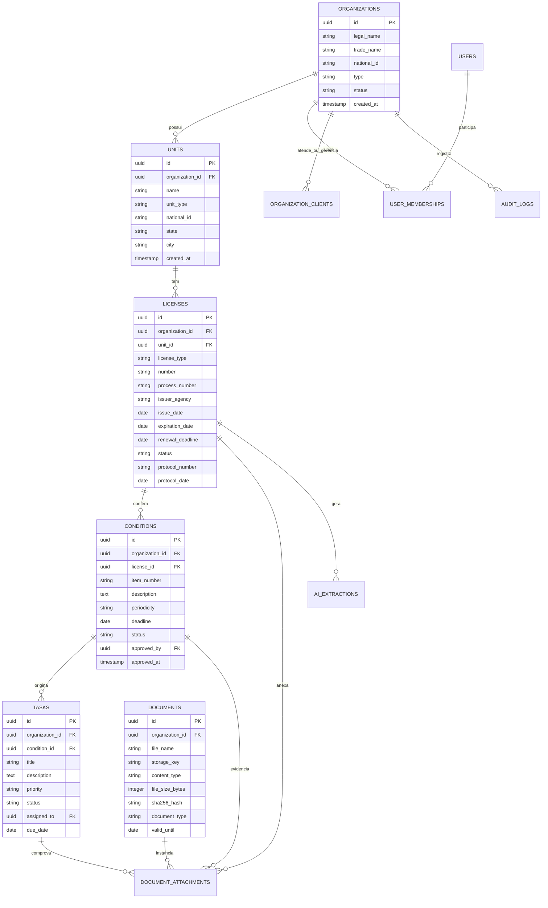
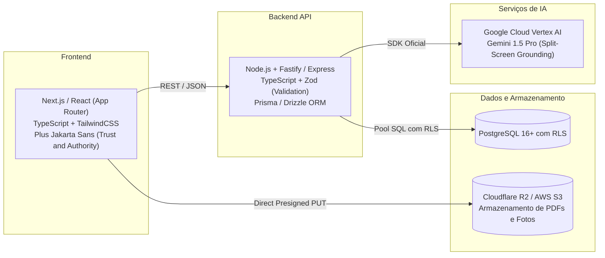

# LIRA AI: Plataforma de Gestão Ambiental SaaS
## Fase 2: Arquitetura Técnica, Modelo de Dados e Contratos de API
**Status:** Documento de Engenharia Aprovado para Implementação  
**Versão:** v1.0  
**Data:** 2026-10-21  
**Filosofia:** Lazy Senior Dev (Ponytail Mindset): YAGNI absoluto, segurança em trust boundaries e prontidão para CodeRabbit.

---

## 1. Decisão Arquitetural Multi-Tenant e Isolamento de Dados

A integridade e o isolamento entre organizações concorrentes e carteiras de clientes de consultorias são inegociáveis (`RB-001` e `RB-002`).

### 1.1 Análise Comparativa de Estratégias

| Estratégia | Complexidade Operacional | Custo de Infraestrutura | Isolamento de Dados | Decisão |
| :--- | :---: | :---: | :---: | :---: |
| **Database-per-tenant** | Altíssima (dezenas/centenas de conexões e migrations individuais) | Elevado | Físico | ❌ Rejeitado (Over-engineering no MVP) |
| **Schema-per-tenant** | Alta (migrations dinâmicas por schema, overhead no Postgres) | Médio | Lógico por Schema | ❌ Rejeitado (Manutenção complexa de DDL) |
| **Shared Database + Row-Level Security (RLS)** | **Baixa a Média** (migration única, pool de conexões otimizado) | **Mínimo** | **Criptográfico / Político no Kernel do BD** | **✅ APROVADO (Padrão de Mercado SaaS)** |

### 1.2 Implementação do Row-Level Security (PostgreSQL)
Toda tabela com escopo de tenant possui a coluna `organization_id UUID NOT NULL REFERENCES organizations(id)`.

No banco de dados PostgreSQL, a política de RLS é imposta no nível do banco, impedindo que bugs de software ou omissão acidental de `WHERE organization_id = ?` vazem dados:

```sql
-- Ativação de RLS na tabela de licenças
ALTER TABLE licenses ENABLE ROW LEVEL SECURITY;

-- Política de isolamento estrito
CREATE POLICY tenant_isolation_policy ON licenses
    AS RESTRICTIVE
    USING (organization_id = NULLIF(current_setting('app.current_tenant_id', true), '')::UUID)
    WITH CHECK (organization_id = NULLIF(current_setting('app.current_tenant_id', true), '')::UUID);
```

#### Middleware de Autenticação e Contexto de Tenant:
A cada requisição HTTP tratada pela API:
1. O token JWT é verificado.
2. O `organization_id` ativo (ou o cliente selecionado no Tenant Switcher pelo consultor autorizado) é validado contra a tabela `organization_clients` ou `user_memberships`.
3. A conexão do pool executa: `SET LOCAL app.current_tenant_id = 'uuid-da-organizacao-ativa'`.

---

## 2. Modelo de Dados Relacional (DER Lógico do Release 1.0)

O diagrama abaixo representa as entidades nucleares do **Core Compliance**:



---

## 3. Especificação Detalhada das Tabelas e Constraints

### 3.1 Tabela `organizations`
Entidade central dos tenants (indústrias contratantes, consultorias e clientes gerenciados).
```sql
CREATE TYPE organization_type AS ENUM ('ENTERPRISE', 'CONSULTANCY', 'MANAGED_CLIENT');
CREATE TYPE organization_status AS ENUM ('TRIAL', 'ACTIVE', 'SUSPENDED', 'CANCELLED');

CREATE TABLE organizations (
    id UUID PRIMARY KEY DEFAULT gen_random_uuid(),
    legal_name VARCHAR(255) NOT NULL,
    trade_name VARCHAR(255) NOT NULL,
    national_id VARCHAR(20) NOT NULL UNIQUE, -- CNPJ ou identificador único
    type organization_type NOT NULL DEFAULT 'ENTERPRISE',
    status organization_status NOT NULL DEFAULT 'TRIAL',
    settings JSONB NOT NULL DEFAULT '{"four_eyes_approval": true, "renewal_alert_days": 120}',
    created_at TIMESTAMPTZ NOT NULL DEFAULT clock_timestamp(),
    updated_at TIMESTAMPTZ NOT NULL DEFAULT clock_timestamp(),
    deleted_at TIMESTAMPTZ NULL
);

CREATE INDEX idx_org_national_id ON organizations(national_id) WHERE deleted_at IS NULL;
```

### 3.2 Tabela `organization_clients` (Vínculo Híbrido Consultoria-Cliente: D-02)
Implementa a decisão aprovada de suporte a clientes autônomos ou gerenciados internamente:
```sql
CREATE TYPE client_relationship_status AS ENUM ('PENDING_INVITATION', 'ACTIVE', 'REVOKED', 'EXPIRED');

CREATE TABLE organization_clients (
    id UUID PRIMARY KEY DEFAULT gen_random_uuid(),
    consultancy_org_id UUID NOT NULL REFERENCES organizations(id) ON DELETE RESTRICT,
    client_org_id UUID NOT NULL REFERENCES organizations(id) ON DELETE RESTRICT,
    relationship_status client_relationship_status NOT NULL DEFAULT 'ACTIVE',
    contract_valid_until DATE NULL,
    authorized_modules JSONB NOT NULL DEFAULT '["LIC", "CON", "TAR", "DOC"]',
    created_at TIMESTAMPTZ NOT NULL DEFAULT clock_timestamp(),
    updated_at TIMESTAMPTZ NOT NULL DEFAULT clock_timestamp(),
    CONSTRAINT uq_consultancy_client UNIQUE(consultancy_org_id, client_org_id)
);
```

### 3.3 Tabela `units`
Locais físicos, filiais e estabelecimentos operacionais:
```sql
CREATE TYPE unit_type AS ENUM ('HEADQUARTERS', 'BRANCH', 'INDUSTRIAL_PLANT', 'CONSTRUCTION_SITE', 'LOGISTICS_HUB');

CREATE TABLE units (
    id UUID PRIMARY KEY DEFAULT gen_random_uuid(),
    organization_id UUID NOT NULL REFERENCES organizations(id) ON DELETE RESTRICT,
    name VARCHAR(255) NOT NULL,
    unit_type unit_type NOT NULL DEFAULT 'INDUSTRIAL_PLANT',
    national_id VARCHAR(20) NULL, -- CNPJ da filial
    state CHAR(2) NOT NULL, -- UF
    city VARCHAR(100) NOT NULL,
    hydrographic_basin VARCHAR(150) NULL,
    latitude NUMERIC(10, 7) NULL,
    longitude NUMERIC(10, 7) NULL,
    created_at TIMESTAMPTZ NOT NULL DEFAULT clock_timestamp(),
    updated_at TIMESTAMPTZ NOT NULL DEFAULT clock_timestamp(),
    deleted_at TIMESTAMPTZ NULL
);

CREATE INDEX idx_units_organization ON units(organization_id) WHERE deleted_at IS NULL;
```

### 3.4 Tabela `licenses`
Instrumentos de licenciamento ambiental com cálculo automático do prazo de renovação tempestiva (120 dias):
```sql
CREATE TYPE license_type AS ENUM ('LP', 'LI', 'LO', 'LAS', 'AAU', 'OUTORGA', 'DISPENSA', 'OUTROS');
CREATE TYPE license_status AS ENUM ('DRAFT', 'ACTIVE', 'RENEWAL_ALERT', 'IN_RENEWAL', 'EXPIRED', 'SUSPENDED', 'CANCELLED', 'ARCHIVED');

CREATE TABLE licenses (
    id UUID PRIMARY KEY DEFAULT gen_random_uuid(),
    organization_id UUID NOT NULL REFERENCES organizations(id) ON DELETE RESTRICT,
    unit_id UUID NOT NULL REFERENCES units(id) ON DELETE RESTRICT,
    license_type license_type NOT NULL,
    number VARCHAR(100) NOT NULL,
    process_number VARCHAR(100) NOT NULL,
    issuer_agency VARCHAR(100) NOT NULL, -- IBAMA, CETESB, INEA, etc.
    description TEXT NULL,
    issue_date DATE NOT NULL,
    expiration_date DATE NOT NULL,
    renewal_deadline DATE GENERATED ALWAYS AS (expiration_date - INTERVAL '120 days') STORED,
    status license_status NOT NULL DEFAULT 'ACTIVE',
    protocol_number VARCHAR(100) NULL,
    protocol_date DATE NULL,
    created_at TIMESTAMPTZ NOT NULL DEFAULT clock_timestamp(),
    updated_at TIMESTAMPTZ NOT NULL DEFAULT clock_timestamp(),
    deleted_at TIMESTAMPTZ NULL,
    CONSTRAINT chk_license_dates CHECK (expiration_date >= issue_date)
);

CREATE INDEX idx_licenses_org_status ON licenses(organization_id, status) WHERE deleted_at IS NULL;
CREATE INDEX idx_licenses_renewal ON licenses(status, expiration_date) WHERE deleted_at IS NULL;
```

### 3.5 Tabela `conditions`
Condicionantes ambientais com FSM formal e suporte a recorrência:
```sql
CREATE TYPE condition_periodicity AS ENUM ('SINGLE', 'MONTHLY', 'BIMONTHLY', 'QUARTERLY', 'SEMIANNUAL', 'ANNUAL', 'CONTINUOUS');
CREATE TYPE condition_status AS ENUM ('PENDING', 'IN_PROGRESS', 'AWAITING_REVIEW', 'COMPLIED', 'OVERDUE', 'WAIVED');

CREATE TABLE conditions (
    id UUID PRIMARY KEY DEFAULT gen_random_uuid(),
    organization_id UUID NOT NULL REFERENCES organizations(id) ON DELETE RESTRICT,
    license_id UUID NOT NULL REFERENCES licenses(id) ON DELETE RESTRICT,
    item_number VARCHAR(50) NOT NULL, -- ex.: "Condicionante 2.1"
    description TEXT NOT NULL,
    compliance_criteria TEXT NOT NULL,
    periodicity condition_periodicity NOT NULL DEFAULT 'SINGLE',
    deadline DATE NOT NULL,
    status condition_status NOT NULL DEFAULT 'PENDING',
    recurrence_parent_id UUID NULL REFERENCES conditions(id),
    reviewed_by UUID NULL,
    reviewed_at TIMESTAMPTZ NULL,
    reviewer_notes TEXT NULL,
    created_at TIMESTAMPTZ NOT NULL DEFAULT clock_timestamp(),
    updated_at TIMESTAMPTZ NOT NULL DEFAULT clock_timestamp(),
    deleted_at TIMESTAMPTZ NULL
);

CREATE INDEX idx_conditions_license ON conditions(license_id, status) WHERE deleted_at IS NULL;
CREATE INDEX idx_conditions_deadline ON conditions(organization_id, deadline, status) WHERE deleted_at IS NULL;
```

### 3.6 Tabela `tasks`
Tarefas operacionais de execução e monitoramento:
```sql
CREATE TYPE task_priority AS ENUM ('LOW', 'MEDIUM', 'HIGH', 'CRITICAL');
CREATE TYPE task_status AS ENUM ('TODO', 'DOING', 'REVIEW', 'DONE', 'OVERDUE', 'CANCELLED');

CREATE TABLE tasks (
    id UUID PRIMARY KEY DEFAULT gen_random_uuid(),
    organization_id UUID NOT NULL REFERENCES organizations(id) ON DELETE RESTRICT,
    condition_id UUID NOT NULL REFERENCES conditions(id) ON DELETE RESTRICT,
    title VARCHAR(255) NOT NULL,
    description TEXT NULL,
    priority task_priority NOT NULL DEFAULT 'MEDIUM',
    status task_status NOT NULL DEFAULT 'TODO',
    assigned_to UUID NULL, -- ID do usuário responsável
    due_date DATE NOT NULL,
    completed_at TIMESTAMPTZ NULL,
    cancellation_reason TEXT NULL,
    created_at TIMESTAMPTZ NOT NULL DEFAULT clock_timestamp(),
    updated_at TIMESTAMPTZ NOT NULL DEFAULT clock_timestamp(),
    deleted_at TIMESTAMPTZ NULL
);

CREATE INDEX idx_tasks_assigned ON tasks(assigned_to, status, due_date) WHERE deleted_at IS NULL;
CREATE INDEX idx_tasks_condition ON tasks(condition_id) WHERE deleted_at IS NULL;
```

### 3.7 Tabela `documents` e `document_attachments`
Armazenamento seguro de evidências com hash criptográfico SHA-256 e integridade de arquivo:
```sql
CREATE TABLE documents (
    id UUID PRIMARY KEY DEFAULT gen_random_uuid(),
    organization_id UUID NOT NULL REFERENCES organizations(id) ON DELETE RESTRICT,
    file_name VARCHAR(255) NOT NULL,
    storage_key VARCHAR(500) NOT NULL, -- Caminho no S3/R2
    content_type VARCHAR(100) NOT NULL,
    file_size_bytes BIGINT NOT NULL,
    sha256_hash CHAR(64) NOT NULL, -- Integridade do documento perante auditorias
    document_type VARCHAR(50) NOT NULL, -- 'LICENSE_PDF', 'LAB_REPORT', 'PHOTO_EVIDENCE', 'PROTOCOL'
    valid_until DATE NULL,
    created_by UUID NOT NULL,
    created_at TIMESTAMPTZ NOT NULL DEFAULT clock_timestamp(),
    deleted_at TIMESTAMPTZ NULL
);

-- Tabela associativa polimórfica controlada para evidências
CREATE TABLE document_attachments (
    id UUID PRIMARY KEY DEFAULT gen_random_uuid(),
    organization_id UUID NOT NULL REFERENCES organizations(id) ON DELETE RESTRICT,
    document_id UUID NOT NULL REFERENCES documents(id) ON DELETE RESTRICT,
    entity_type VARCHAR(50) NOT NULL, -- 'LICENSE', 'CONDITION', 'TASK'
    entity_id UUID NOT NULL,
    attached_at TIMESTAMPTZ NOT NULL DEFAULT clock_timestamp(),
    attached_by UUID NOT NULL
);

CREATE INDEX idx_doc_attach_target ON document_attachments(entity_type, entity_id);
```

### 3.8 Tabela `audit_logs` (Imutabilidade e Trilha de Auditoria: RB-003)
```sql
CREATE TABLE audit_logs (
    id UUID PRIMARY KEY DEFAULT gen_random_uuid(),
    organization_id UUID NOT NULL REFERENCES organizations(id) ON DELETE RESTRICT,
    user_id UUID NULL,
    action VARCHAR(50) NOT NULL, -- 'CREATE', 'UPDATE', 'DELETE', 'STATUS_CHANGE', 'DOWNLOAD'
    entity_name VARCHAR(50) NOT NULL,
    entity_id UUID NOT NULL,
    old_values JSONB NULL,
    new_values JSONB NULL,
    client_ip VARCHAR(45) NULL,
    user_agent TEXT NULL,
    created_at TIMESTAMPTZ NOT NULL DEFAULT clock_timestamp()
);

-- Particionamento mensal ou retenção segura para desempenho
CREATE INDEX idx_audit_entity ON audit_logs(organization_id, entity_name, entity_id);
```

---

## 4. Arquitetura de API e Padrão de Contratos (RESTful)

### 4.1 Convenções de Rota e Headers
- **Prefixo de Rota**: `/api/v1/...`
- **Headers Mandatórios**:
  - `Authorization: Bearer <JWT_TOKEN>`
  - `X-Tenant-Id: <UUID>` (Identifica o contexto de tenant selecionado)
- **Content-Type**: `application/json; charset=utf-8`

### 4.2 Padrão de Erros Uniforme (RFC 7807 Problem Details)
Toda resposta de erro na API retorna estrutura padronizada com código claro, evitando erros genéricos:
```json
{
  "type": "https://api.lira.ai/errors/condition-evidence-required",
  "title": "Evidence Required for Condition Review",
  "status": 422,
  "detail": "Não é possível submeter a condicionante CON-042 para revisão sem anexar ao menos uma evidência comprobatória (RB-004).",
  "instance": "/api/v1/conditions/d3b07384-d113-4a61-9c12-32a76f2d22b1/submit-review",
  "code": "RB_004_EVIDENCE_MANDATORY"
}
```

### 4.3 Endpoints Nucleares do Release 1.0

#### Módulo Licenças (`/api/v1/licenses`)
- `GET /api/v1/licenses`: Listagem paginada com filtros por unidade, órgão, status e intervalo de vencimento.
- `POST /api/v1/licenses`: Cadastro de licença com validação de arquivo anexado.
- `GET /api/v1/licenses/{id}`: Detalhamento com resumo de condicionantes vinculadas.
- `PATCH /api/v1/licenses/{id}`: Atualização cadastral.
- `POST /api/v1/licenses/{id}/record-protocol`: Registro de protocolo formal de renovação tempestiva.
- `POST /api/v1/licenses/ai-extract`: Upload de PDF para extração assistida por IA (LIRA Extract).

#### Módulo Condicionantes (`/api/v1/conditions`)
- `GET /api/v1/conditions`: Listagem com filtros por licença, responsável, prazo e status.
- `POST /api/v1/conditions`: Cadastro individual de condicionante.
- `POST /api/v1/conditions/bulk`: Cadastro em lote pós-homologação de extração por IA.
- `POST /api/v1/conditions/{id}/submit-review`: Solicitação de homologação de atendimento (valida evidências).
- `POST /api/v1/conditions/{id}/approve`: Homologação técnica por usuário Gestor/Auditor (`RB-006`).
- `POST /api/v1/conditions/{id}/reject`: Devolução para correção com parecer técnico.

#### Módulo Tarefas (`/api/v1/tasks`)
- `GET /api/v1/tasks`: Lista de tarefas com suporte a paginação e visão Kanban (agrupada por status).
- `POST /api/v1/tasks`: Criação de tarefa vinculada a condicionante.
- `PATCH /api/v1/tasks/{id}/status`: Transição de estado da tarefa com regras de evidência.

#### Módulo Documentos e Upload Direto (`/api/v1/documents`)
- `POST /api/v1/documents/presigned-upload-url`: Geração de URL pré-assinada S3/R2 para upload direto do frontend (zero carga no servidor de aplicação).
- `POST /api/v1/documents/confirm`: Confirmação do upload com cálculo/conferência de hash SHA-256 e gravação de metadados.
- `GET /api/v1/documents/{id}/download-url`: Geração de URL temporária segura de download (expira em 15 minutos).

---

## 5. Stack Tecnológica Recomendada (Pragmática e Sem Bloat)

Alinhado à filosofia **Lazy Senior Dev**:



### Por que esta stack?
1. **TypeScript ponta a ponta**: Compartilhamento de contratos e schemas de validação (`Zod`) entre backend e frontend. Zero duplicação de interfaces.
2. **PostgreSQL com RLS**: Uma única instância gerenciada com isolamento multi-tenant a nível de kernel. Sem custo de orquestrar centenas de bancos separados.
3. **Upload Direto via Presigned URLs**: PDFs de 50MB de licenças ambientais vão direto do navegador do usuário para o Object Storage (R2/S3). A API da LIRA AI não sofre gargalos de I/O de rede ou memória.
4. **Gemini 1.5 Pro via Vertex AI**: Janela de contexto massiva (até 1M tokens) para leitura de licenças digitalizadas de centenas de páginas com alta velocidade e baixo custo.

---

## 6. Estratégia de Testes Automatizados (CodeRabbit Ready)

Para garantir que a base permaneça sem regressões e que o CodeRabbit aprove PRs com confiança:

1. **Testes de Isolamento RLS (Security Tests)**:
   - Injetar requisições simuladas tentando ler registros de outro tenant com ID forjado na URL e validar retorno obrigatório `404 Not Found`.
2. **Testes de Invariantes de Negócio (Unit Tests)**:
   - Validar bloqueio de transição para `AWAITING_REVIEW` sem documentos anexados (`RB-004`).
   - Validar bloqueio de autoaprovação de condicionante pelo mesmo executor (`RB-006`).
   - Validar cálculo da coluna gerada de 120 dias (`renewal_deadline`).
3. **Testes de Idempotência (Background Jobs)**:
   - Rodar o job diário de alertas de renovação múltiplas vezes seguidas e verificar que nenhuma notificação duplicada foi criada para o mesmo ciclo.
