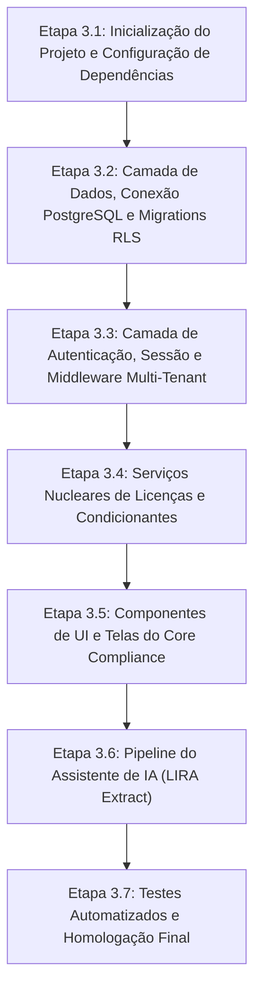

# LIRA AI: Plataforma de Gestão Ambiental SaaS
## Fase 3: Plano de Implementação, Estrutura do Repositório e Especificação de Telas
**Status:** Documento de Planejamento de Engenharia  
**Versão:** v1.0  
**Data:** 2026-10-21  
**Filosofia:** Lazy Senior Dev (Ponytail Mindset): Menor quantidade de código, YAGNI absoluto e prontidão para CodeRabbit.

---

## 1. Organização do Repositório e Estrutura de Diretórios

Para manter a simplicidade (sem overhead de monorepos complexos como Turborepo ou Nx no primeiro momento), o projeto utiliza uma estrutura modular e limpa:

```
lira-ai/
├── design-system/
│   └── lira-ai/
│       └── MASTER.md                # Diretrizes de UI/UX, cores e tokens
├── docs/
│   ├── especificacao-funcional-v0.1.md
│   ├── especificacao-funcional-detalhada-v0.2.md
│   ├── fase-2-arquitetura-tecnica-e-dados.md
│   └── fase-3-plano-implementacao-e-telas.md
├── src/
│   ├── app/                         # Rotas e páginas da aplicação
│   │   ├── (auth)/                  # Rotas públicas de login e convite
│   │   └── (dashboard)/             # Rotas autenticadas do sistema
│   │       ├── licenses/            # Módulo de Licenciamento
│   │       ├── conditions/          # Módulo de Condicionantes
│   │       ├── tasks/               # Módulo de Tarefas Operacionais
│   │       ├── documents/           # Módulo de Gestão Documental
│   │       └── settings/            # Configurações de Organizações e Usuários
│   ├── components/                  # Componentes reutilizáveis de UI
│   │   ├── ui/                      # Botões, inputs, modais e badges
│   │   ├── layout/                  # Barra lateral, cabeçalho e tenant switcher
│   │   └── modules/                 # Componentes específicos de cada módulo
│   ├── lib/
│   │   ├── db/                      # Conexão com PostgreSQL e instâncias RLS
│   │   ├── services/                # Regras de negócio e transações
│   │   ├── validators/              # Schemas Zod para formulários e requisições
│   │   └── storage/                 # Integração com S3 e Cloudflare R2
│   └── types/                       # Interfaces TypeScript do Core Compliance
├── tests/
│   ├── unit/                        # Testes unitários de regras de negócio
│   └── integration/                 # Testes de isolamento RLS e endpoints
├── README.md
├── .gitignore
└── package.json
```

---

## 2. Especificação das Telas do Core Compliance (Release 1.0)

Abaixo estão detalhadas as interfaces essenciais para a operação comercial do Release 1.0, seguindo rigorosamente os padrões de Trust and Authority e Enterprise Gateway do design system.

---

### Tela 01: Login e Seleção de Tenant (Tenant Switcher)
- **Objetivo**: Autenticar o usuário e definir o contexto de organização ativa.
- **Elementos Visuais**:
  - Logotipo institucional LIRA AI com tipografia Plus Jakarta Sans.
  - Formulário com campos de e-mail e senha, com validação instantânea.
  - Botão de ação primária em azul corporativo (`#0369A1`) com efeito de hover suave.
  - Para consultores ambientais vinculados a múltiplos clientes: modal ou dropdown superior exibindo a lista de organizações autorizadas com busca rápida.
- **Acessibilidade**: Foco visível nos inputs, mensagens de erro associadas via `aria-describedby` e suporte completo a navegação por teclado.

---

### Tela 02: Painel Central de Conformidade Ambiental (Dashboard)
- **Objetivo**: Proporcionar ao Gestor Ambiental e ao Consultor uma visão panorâmica imediata dos riscos e prazos.
- **Componentes**:
  - **Barra Superior**: Nome da organização/cliente ativo, seletor de unidade operacional e notificações de prazos.
  - **Cartões de Métricas (KPI Cards)**:
    - *Licenças Vigentes*: Contador em verde (`#059669`).
    - *Licenças em Renovação (Alerta 120 dias)*: Contador em âmbar (`#D97706`).
    - *Licenças Vencidas*: Contador em vermelho (`#DC2626`).
    - *Condicionantes a Vencer nos Próximos 30 Dias*: Alerta visual de alta prioridade.
    - *Fila de Homologação (Quatro-Olhos)*: Quantidade de itens aguardando aprovação técnica.
  - **Tabela de Ações Urgentes**: Lista filtrada com as 10 atividades mais próximas do vencimento fatal.

---

### Tela 03: Gestão de Licenças Ambientais (Listagem e Cadastro)
- **Objetivo**: Controlar o ciclo de vida dos instrumentos ambientais (LP, LI, LO, LAS).
- **Recursos Principais**:
  - Filtros laterais por órgão emissor (IBAMA, CETESB, INEA, etc.), unidade e status.
  - Tabela com colunas: Instrumento, Número, Órgão, Unidade, Vencimento, Prazo Limite de Renovação e Status Visual.
  - Badges semânticos de status com bordas e contrastes adequados ao padrão WCAG AAA.
  - Botão de ação para cadastrar nova licença ou registrar protocolo de renovação tempestiva.

---

### Tela 04: Visualizador LIRA Extract (Extração por IA em Split-Screen)
- **Objetivo**: Permitir a revisão e homologação humana rápida de condicionantes extraídas de PDFs.
- **Estrutura de Duplo Painel (Split-Screen)**:
  - **Painel da Esquerda (50%)**: Visualizador de PDF integrado, com destaque visual nas páginas e parágrafos de onde a IA extraiu as cláusulas.
  - **Painel da Direita (50%)**: Lista editável das condicionantes propostas pela IA, contendo número do item, texto extraído, periodicidade e prazo sugerido.
  - **Controles por Item**: Botões individuais de *Aprovar*, *Editar* e *Descartar*.
  - **Ação Global**: Botão *Homologar e Salvar no Sistema* (só habilitado após conferência humana).

---

### Tela 05: Fila de Homologação de Condicionantes (Quatro-Olhos)
- **Objetivo**: Garantir que nenhuma condicionante seja encerrada sem validação técnica independente (`RB-006`).
- **Elementos**:
  - Lista de condicionantes com status `AGUARDANDO_REVISAO`.
  - Pré-visualização instantânea dos laudos laboratoriais e relatórios comprobatórios anexados (`RB-004`).
  - Campo de parecer técnico do auditor/gestor.
  - Botões de decisão: *Homologar Atendimento* (Verde) e *Devolver para Ajuste* (Âmbar com justificativa obrigatória).

---

### Tela 06: Central de Tarefas Operacionais (Kanban e Lista)
- **Objetivo**: Permitir que analistas e equipes operacionais executem atividades de rotina vinculadas a condicionantes.
- **Alternância de Visão**:
  - *Visão Kanban*: Colunas organizadas por *A Fazer*, *Em Execução*, *Em Revisão* e *Concluída*.
  - *Visão Lista*: Modo compacto ordenado por data limite com indicação visual de prioridade.
- **Gaveta de Detalhe da Tarefa (Drawer)**:
  - Exibição da condicionante e licença mãe.
  - Área de upload de fotos e laudos com pré-visualização de arquivos.
  - Histórico de comentários técnicos e movimentações de status.

---

## 3. Roteiro Passo a Passo de Implementação (Fase 3 em Diante)

Para manter entregas contínuas, sem quebras e com diffs limpos e objetivos (preparados para aprovação pelo CodeRabbit):



### Detalhamento das Etapas:
1. **Etapa 3.1**: Configurar `package.json`, TypeScript, ESLint e estrutura base de diretórios.
2. **Etapa 3.2**: Implementar as migrations SQL das tabelas nucleares com políticas de RLS e funções de auditoria.
3. **Etapa 3.3**: Desenvolver os middlewares de verificação de token JWT e injeção de contexto `app.current_tenant_id`.
4. **Etapa 3.4**: Codificar as regras de negócio de licenças (cálculo de 120 dias da LC 140/2011) e máquinas de estado de condicionantes (bloqueio sem evidência e aprovação por quatro-olhos).
5. **Etapa 3.5**: Construir os componentes visuais com Plus Jakarta Sans, paleta Trust and Authority e semântica de cores.
6. **Etapa 3.6**: Integrar o pipeline de extração por IA em split-screen com Google Gemini via Vertex AI.
7. **Etapa 3.7**: Executar testes de ponta a ponta e testes de segurança RLS para validação final.
